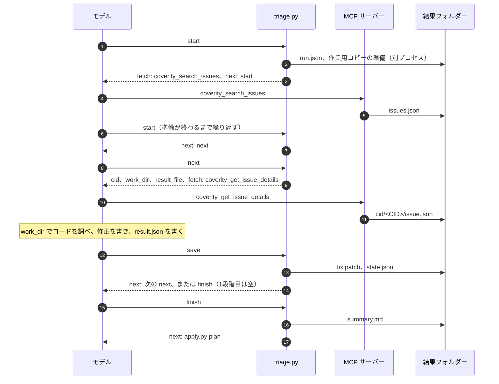
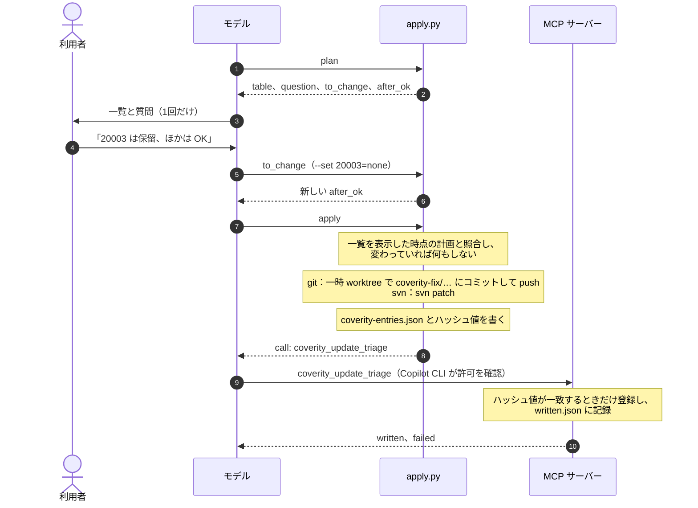
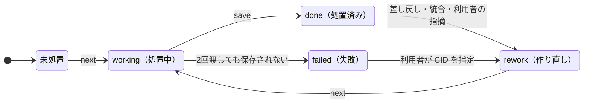

# 仕組み

**処置の順序は文章が持ち、状態はフォルダーが持ちます。** スキルとエージェントの文章は「スクリプトの応答に書かれたコマンドを実行する」ことだけを決め、スクリプトが状態を結果フォルダーに保存します。会話が途切れても、同じ依頼で続きから再開できるのはこのためです。

## 構成

| 構成要素 | 場所 | 役割 |
| --- | --- | --- |
| MCP サーバー `coverity-connect` | `mcp-servers/coverity-connect/` | Coverity Connect との通信。接続の確認、警告の検索、経路の取得、登録の4ツール |
| スキル `coverity-setup` | `skills/coverity-setup/` | 設定ファイルの作成と確認（`setup.py`） |
| スキル `coverity-triage` | `skills/coverity-triage/` | CID 1件の処置の方法（`SKILL.md`、`references/`）と進行（`triage.py`） |
| スキル `coverity-apply` | `skills/coverity-apply/` | 一覧と、OK の後の取り込み（`apply.py`） |
| スキル `coverity-gui` | `skills/coverity-gui/` | ローカルの画面（`gui.py`、`static/`） |
| エージェント | `com.github.copilot/agents/` | `triage-worker`（2段階目と、3段階目の処置役）、`triage-orchestrator`（3段階目の進行）、`triage-reviewer`（検証）、`triage-integrator`（統合） |

スキルのフォルダーは、ほかのフォルダーのコードを読み込みません。スキルの間の取り決めは、結果フォルダーのファイルの形だけです。

## スクリプトの応答

`triage.py` と `apply.py` のコマンドは、JSON を1つ返します。モデルは、この応答だけを見て次に進みます。

| キー | 内容 |
| --- | --- |
| `next` | 続けて実行するコマンドの全文。**利用者の言葉を待たずに実行してよいものだけ**を入れます。空なら、利用者の入力を待ちます |
| `fetch` | 先に呼び出す MCP のツールと引数 |
| `message` | 利用者に伝える文 |
| `ok`、`error`、`problems` | 失敗したか。`problems` は、モデルが訂正して再実行できる項目 |
| `take` | CID を受け取るコマンド。1段階目で、利用者が CID を指定したときに使います |
| `after_ok` | OK の後に実行するコマンド（`apply.py apply`） |
| `to_change` | 選択を変えるときに `--set` を書き換えて実行するコマンド |
| `call`、`if_not_called` | 呼び出す登録のツールと、呼び出せなかったときに文字を変えずに伝える文 |

- コマンドは、1回の呼び出しで1行を、書かれたとおりに実行させます。スキルの `allowed-tools` は `shell(uv run:*)` なので、シェルの変数、`;`、`&&`、パイプ、`cd` を使った形は許可されません。
- 流れを応答で決めるのは、小型のモデルが、スキルの文章の離れた箇所より、目の前の応答に従うためです。実際のモデルでの確認で、応答で決めないと1段階目の手順が守られないことが分かりました。

## 処置の流れ

- 作業用コピーは、git では取り込み先のブランチの最新のコミットの worktree、svn ではチェックアウトのコピーです。利用者の作業ツリーは編集しません。並列の処置役も、互いの修正の影響を受けません。
- `save` は、結果の形式と逸脱コメントの規則（`checks.py`）を確認し、`git diff` / `svn diff` の出力をバイト列のまま `fix.patch` に保存します。文字コードと改行コードを変えないためです。
- 作業用コピーの準備、ビルド確認、最初の解析は時間がかかるため、切り離したプロセスで実行し、同じコマンドをもう一度呼んで完了を確認します。
- 取り込み先のブランチが変わった後の依頼は、新しい結果フォルダーを作ります。1つの結果フォルダーの修正は、すべて同じリビジョンが基準です。

## OK の後

- `apply` を `next` ではなく `after_ok` に入れるので、応答に従うだけのモデルが OK の前に取り込むことはありません。
- 選択の優先順位は、チャットでの指定、画面での選択、推奨の順です。
- 保留の CID にも「Pending」を登録します。未分類のまま残すと、次の取得で（ほかの人の PC でも）もう一度処置されるためです。

## 結果フォルダー

`<output_dir>/<年月日-時分秒>/` が、1回の取得とその処置の状態のすべてです。**ファイルごとに、書き込む構成要素は1つです。**

| ファイル | 書き込むもの | 内容 |
| --- | --- | --- |
| `run.json` | `triage.py` | リポジトリ、git / svn、取り込み先のリビジョン、ストリーム、条件、並列数、検証の有無 |
| `issues.json`、`cid/<CID>/issue.json` | MCP サーバー | 警告の一覧、警告の経路 |
| `cid/<CID>/state.json` | `triage.py` | CID の状態、検証の結果、統合の関係 |
| `cid/<CID>/result.json` | 処置役のモデル（`save` が Coverity の値を追記） | 判定、根拠、推奨、確信度、逸脱コメント |
| `cid/<CID>/fix.patch`、`review.json` | `triage.py` | 修正コード、検証の結果と指摘 |
| `summary.md` | `triage.py` | 全 CID の2つの出力 |
| `decisions.json` | `gui.py` | 画面での選択と、編集した逸脱コメント |
| `apply-plan.json`、`applied.json`、`coverity-entries.json` | `apply.py` | 一覧を表示した時点の計画、取り込んだ修正、登録する内容 |
| `written.json` | MCP サーバー | Coverity に登録済みの CID |
| `work/` | `triage.py` | 作業用コピー。完了時に削除 |

## CID の状態

- 統合された CID は `merged_into` を持ち、代表の CID の修正と逸脱コメントを共有します。
- 検証の結果は、合格（`pass`）、要確認（`flag`）、差し戻し（`rework`）、未検証（`unverified`）です。差し戻しは1回だけ作り直します。

## 3段階目の進め方

`triage-orchestrator` は、`status` の応答を見て、最初に当てはまるものを行い、また `status` に戻ります。

1. `next` に `next` のコマンドがある：その行の数だけ `triage-worker` を同時に起動します。
2. 統合の候補（同じチェッカーと関数、または修正が同じ行を変更）がある：`triage-integrator` に1回だけ依頼します。
3. `next` が `review` のコマンド：`triage-reviewer` を同時に起動します。2回依頼しても残った CID は、未検証として記録します。
4. `next` が `finish` のコマンド：完了して、一覧に進みます。

依頼先は3つのエージェントだけです。`tools` では依頼先を絞れないため、エージェントの frontmatter のフック（bash と PowerShell）で、ほかへの依頼を拒否します。

## 画面

`gui.py` は、127.0.0.1 だけで待ち受ける HTTP サーバーです。結果フォルダーを読んで表示し、書き込むのは `decisions.json` だけです。URL のトークンと、`Host`・`Origin` の確認で、ほかのページやほかの PC からの要求を拒否します。要求が30分ないと止まります。

## 設計上の決定

| 決定 | 理由 |
| --- | --- |
| どの段階も同じコマンドを使う | どの段階の結果も、同じ画面と同じ OK の手順で扱えます |
| 一覧は1つ、質問は1回 | 利用者が確認する対象と、OK の意味を1つにします |
| 取り込み先は、チェックアウトしているブランチ | 利用者が作業しているブランチの最新のコードで処置し、そのブランチへのプルリクエストを用意します |
| テスト用の動作を出荷するコードに入れない | テストは、Coverity Connect の代わりの HTTP サーバー（`tests/coverity_emulator`）に接続します |

詳しくは[設計書](gh:docs/design/design.md)にあります。
