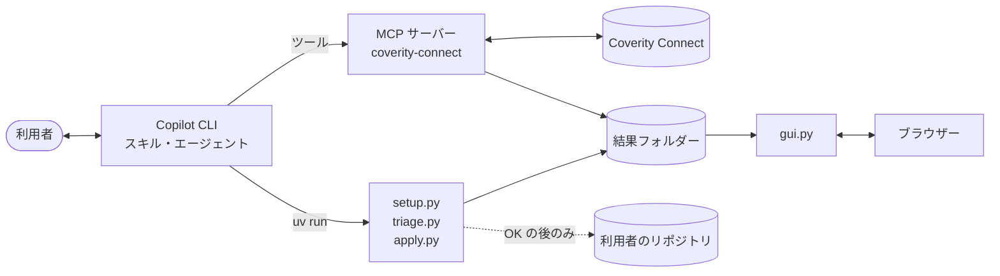
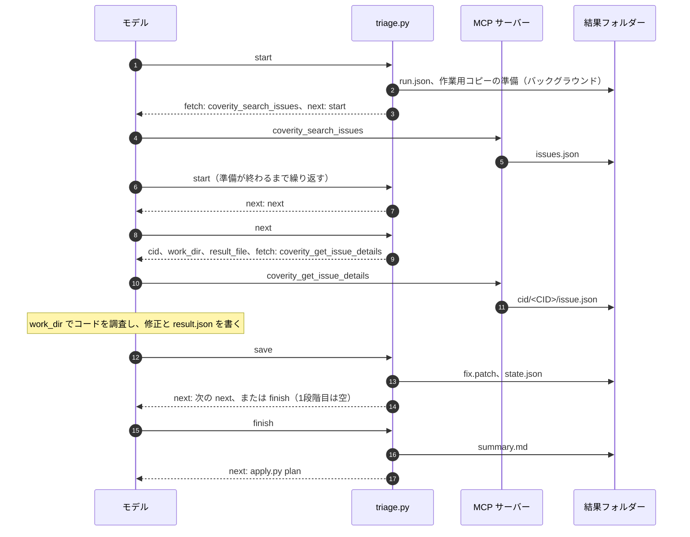
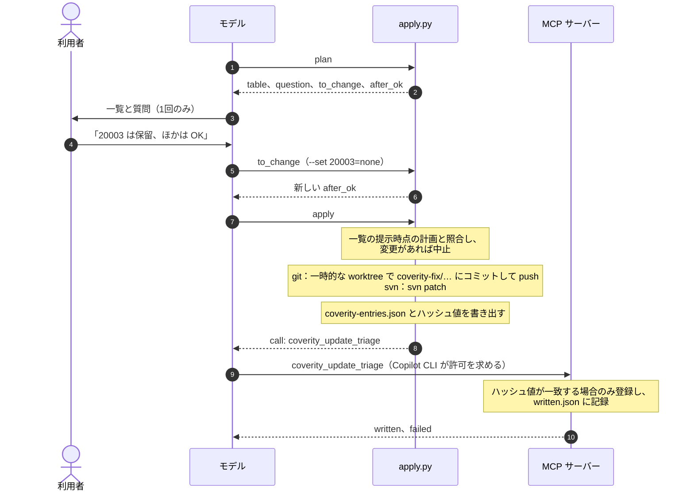
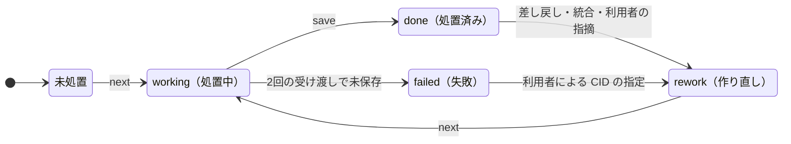

# アーキテクチャ

処置の手順はスクリプトの応答で指示し、状態は結果フォルダーに保存します。スキルとエージェントの定義に書くのは、「応答に含まれるコマンドを実行する」という規則だけです。この設計により、会話が中断しても同じ依頼で再開でき、どの段階で処置した結果も、同じ一覧と同じ画面で扱えます。

## 構成

| 構成要素 | 場所 | 役割 |
| --- | --- | --- |
| MCP サーバー `coverity-connect` | `mcp-servers/coverity-connect/` | Coverity Connect との通信（接続確認、警告の検索、経路の取得、登録の4ツール） |
| スキル `coverity-setup` | `skills/coverity-setup/` | 設定ファイルの作成と検証（`setup.py`） |
| スキル `coverity-triage` | `skills/coverity-triage/` | CID 1件の処置方法（`SKILL.md`、`references/`）と、全体の進行管理（`triage.py`） |
| スキル `coverity-apply` | `skills/coverity-apply/` | 一覧の作成と、OK の後の取り込み（`apply.py`） |
| スキル `coverity-gui` | `skills/coverity-gui/` | ローカルの Web 画面（`gui.py`、`static/`） |
| エージェント | `com.github.copilot/agents/` | `triage-worker`（2段階目の処置と3段階目の個別処置）、`triage-orchestrator`（3段階目の進行）、`triage-reviewer`（検証）、`triage-integrator`（統合） |

各スキルは、ほかのフォルダーのコードを読み込みません。スキル間のインターフェースは、結果フォルダーのファイル形式のみです。

## スクリプトの応答

`triage.py` と `apply.py` の各コマンドは JSON オブジェクトを1つ出力し、モデルはその内容に従って次の操作を決めます。

| キー | 内容 |
| --- | --- |
| `next` | 次に実行するコマンドの全文。**利用者の応答を待たずに実行してよいコマンドに限る**。空の場合は利用者の入力を待つ |
| `fetch` | 先に呼び出す MCP ツールと引数 |
| `message` | 利用者に表示する文 |
| `ok`、`error`、`problems` | `ok` が `false` のとき失敗。`error` は原因、`problems` はモデルが修正して再実行できる項目 |
| `take` | CID を受け取るコマンド。チャットで利用者が CID を指定した場合に使用 |
| `after_ok` | 利用者の OK の後に実行するコマンド（`apply.py apply`） |
| `to_change` | 選択を変更する場合に、`--set` を書き換えて実行するコマンド |
| `call`、`if_not_called` | 呼び出す登録用ツールと、呼び出せなかった場合にそのまま表示する文 |

- コマンドは1回につき1行ずつ、記載どおりに実行させます。スキルの `allowed-tools` が `shell(uv run:*)` であるため、シェル変数、`;`、`&&`、パイプ、`cd` を含むコマンドは許可されません。
- 手順をスキルの本文ではなく応答で示すのは、小規模なモデルほど、本文の離れた箇所より直前の応答に従う傾向があるためです。実際のモデルでの評価では、応答で手順を示さない場合、1段階目の手順が守られませんでした。

## 処置の流れ

- 作業用コピーは、git では取り込み先ブランチの最新コミットから作成する worktree、svn では別途チェックアウトしたコピーです。利用者の作業ツリーは変更せず、並列に処置するエージェント同士も互いの修正の影響を受けません。
- 取り込み先は、設定の `base_branch`、未指定の場合はチェックアウト中のブランチです。利用者が作業中のブランチの最新コードで処置し、そのブランチへのプルリクエストを作成できるようにするためです。取り込み先が変わった場合は、新しい結果フォルダーを作成します（1つの結果フォルダー内の修正は、すべて同じリビジョンを基準とするため）。
- `save` は、結果の形式と逸脱コメントの規則（`checks.py`）を検査し、`git diff` / `svn diff` の出力をバイト列のまま `fix.patch` に保存します。文字コードと改行コードを保持するためです。
- 作業用コピーの準備、ビルドによる確認、取得前の解析は時間がかかるため、バックグラウンドで実行し、同じコマンドを再度呼び出して完了を確認します。

## OK 後の処理

- `apply` は `next` ではなく `after_ok` で返すため、応答に従うだけのモデルが、OK の前に取り込みを実行することはありません。
- 利用者への質問は、一覧の提示時の1回に限ります。確認の対象と OK の意味を1つにするためです。
- 選択の優先順位は、チャットでの指定、画面での選択、AI の推奨の順です。
- 保留にした CID にも「Pending」を登録します。未分類のままにすると、次回の取得で（ほかの利用者の環境でも）再び処置の対象になるためです。

## 結果フォルダー

`<output_dir>/<年月日-時分秒>/` には、1回の取得とその処置に関する状態がすべて格納されます。**各ファイルの書き込み元は、1つの構成要素に限定しています。**

| ファイル | 書き込み元 | 内容 |
| --- | --- | --- |
| `run.json` | `triage.py` | リポジトリ、git / svn の別、取り込み先のリビジョン、ストリーム、条件、並列数、検証の有無 |
| `issues.json`、`cid/<CID>/issue.json` | MCP サーバー | 警告の一覧、警告の経路 |
| `cid/<CID>/state.json` | `triage.py` | CID の状態、検証結果、統合関係 |
| `cid/<CID>/result.json` | 処置したモデル（Coverity 用の値は `save` が追記） | 判定、根拠、推奨、確信度、逸脱コメント |
| `cid/<CID>/fix.patch`、`review.json` | `triage.py` | 修正コード、検証結果と指摘 |
| `summary.md` | `triage.py` | 全 CID の修正コードと逸脱コメント |
| `decisions.json` | `gui.py` | 画面での選択と、編集した逸脱コメント |
| `apply-plan.json`、`applied.json`、`coverity-entries.json` | `apply.py` | 一覧の提示時点の計画、取り込んだ修正、登録内容 |
| `written.json` | MCP サーバー | Coverity に登録済みの CID |
| `work/` | `triage.py` | 作業用コピー。完了時に削除 |

## CID の状態遷移

- 統合された CID は `merged_into` を持ち、代表 CID の修正と逸脱コメントを共有します。
- 検証結果は、合格（`pass`）、要確認（`flag`）、差し戻し（`rework`）、未検証（`unverified`）のいずれかです。差し戻しによる作り直しは1回までです。

## 3段階目の制御

`triage-orchestrator` は `status` の応答を評価し、次のうち最初に該当する処理を実行した後、再び `status` を呼び出します。

1. `next` に `next` コマンドがある：その行数分の `triage-worker` を並列に起動する
2. 統合候補（同一チェッカーかつ同一関数、または修正が同じ行を変更）がある：`triage-integrator` に1回だけ依頼する
3. `next` が `review` コマンド：`triage-reviewer` を並列に起動する。2回依頼しても残った CID は未検証として記録する
4. `next` が `finish` コマンド：処置を終了し、一覧の提示に進む

委任先は、この3つのエージェントに限定しています。`tools` では委任先を制限できないため、エージェントの frontmatter に記述したフック（bash と PowerShell）で、ほかへの委任を拒否します。

## Web 画面

`gui.py` は、127.0.0.1 のみで待ち受ける HTTP サーバーです。結果フォルダーを読み取って表示し、書き込むのは `decisions.json` のみです。URL のトークンと、`Host`・`Origin` ヘッダーの検査により、ほかのページやほかの PC からの要求を拒否します。30分間要求がなければ終了します。

設計判断の詳細は[設計書](gh:docs/design/design.md)を参照してください。
