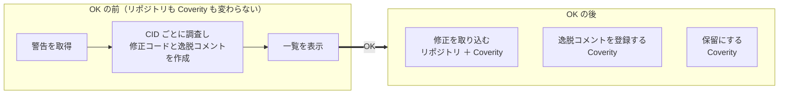

# coverity-triage-kit

Coverity Connect の警告を CID ごとに調べ、**修正コード**と**逸脱コメント**を両方用意する、GitHub Copilot CLI のプラグインです。対象は C / C++ です。どちらを採用するかは、最後に一覧で決めます。

調査と修正は、リポジトリの外の作業用コピーで行います。Coverity に書き込む前には、Copilot CLI が許可を求めます。

-   :material-rocket-launch-outline:{ .lg } **初めて使う**

    ---

    準備をして、1件の警告で、調査から OK までを試します。

    [:octicons-arrow-right-24: 準備する](use/setup.md)

-   :material-robot-outline:{ .lg } **まとめて処置する**

    ---

    条件に合う警告を、エージェントに最後まで任せます。

    [:octicons-arrow-right-24: まとめて任せる](use/delegate.md)

-   :material-lifebuoy:{ .lg } **うまく動かない**

    ---

    表示されたメッセージを貼り付けて、対処を探します。

    [:octicons-arrow-right-24: 困ったとき](use/trouble.md)

-   :material-source-branch:{ .lg } **プラグインを開発する**

    ---

    守る決まりと、それを確認するテストから読みます。

    [:octicons-arrow-right-24: 始める前に](dev/index.md)

