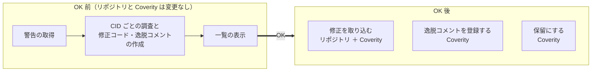

# coverity-triage-kit

Coverity Connect の警告を CID ごとに調べ、**修正コード**と**逸脱コメント**を両方用意する、GitHub Copilot CLI のプラグインです。対象は C / C++ です。どちらを採用するかは、最後に一覧で決めます。

-   :material-rocket-launch-outline:{ .lg } **初めての利用**

    ---

    準備をして、1件の警告で、調査から OK までを試します。

    [:octicons-arrow-right-24: 準備](use/setup.md)

-   :material-robot-outline:{ .lg } **一括処置**

    ---

    条件に合う警告を、エージェントに最後まで任せます。

    [:octicons-arrow-right-24: エージェントによる一括処置](use/delegate.md)

-   :material-lifebuoy:{ .lg } **動作の不具合**

    ---

    表示されたメッセージを貼り付けて、対処を探します。

    [:octicons-arrow-right-24: トラブルシューティング](use/trouble.md)

-   :material-source-branch:{ .lg } **プラグインの開発**

    ---

    設計原則と、それを検査するテストから確認します。

    [:octicons-arrow-right-24: 概要と原則](dev/index.md)

