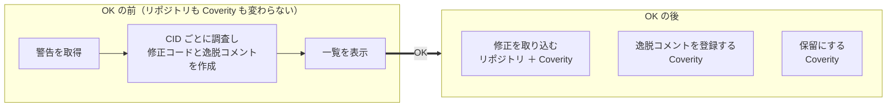

# coverity-triage-kit

Coverity Connect の警告を CID ごとに調べ、**修正コード**と**逸脱コメント**の両方を用意する GitHub Copilot CLI のプラグインです。対象は C / C++ です。どちらを採用するかは、一覧を見て決めます。

[準備を始める](use/setup.md){ .md-button .md-button--primary }
[仕組みを読む](dev/architecture.md){ .md-button }

調査と修正は、リポジトリの外の作業用コピーで行います。Coverity に書き込む直前には、Copilot CLI が許可を確認します。

-   :material-rocket-launch-outline:{ .lg } **初めて使う**

    ---

    [準備](use/setup.md)をして、[1件ずつ処置](use/first.md)し、[一覧で決める](use/decide.md)まで進めます。

-   :material-robot-outline:{ .lg } **まとめて処置する**

    ---

    エージェントに[まとめて任せ](use/delegate.md)、結果を一覧か[画面](use/screen.md)で選びます。

-   :material-lifebuoy:{ .lg } **うまく動かない**

    ---

    表示されたメッセージの一部で、[困ったとき](use/trouble.md)を絞り込みます。

-   :material-source-branch:{ .lg } **プラグインを変更する**

    ---

    [始める前に](dev/index.md)で、守る決まりと、それを確認するテストを読みます。

