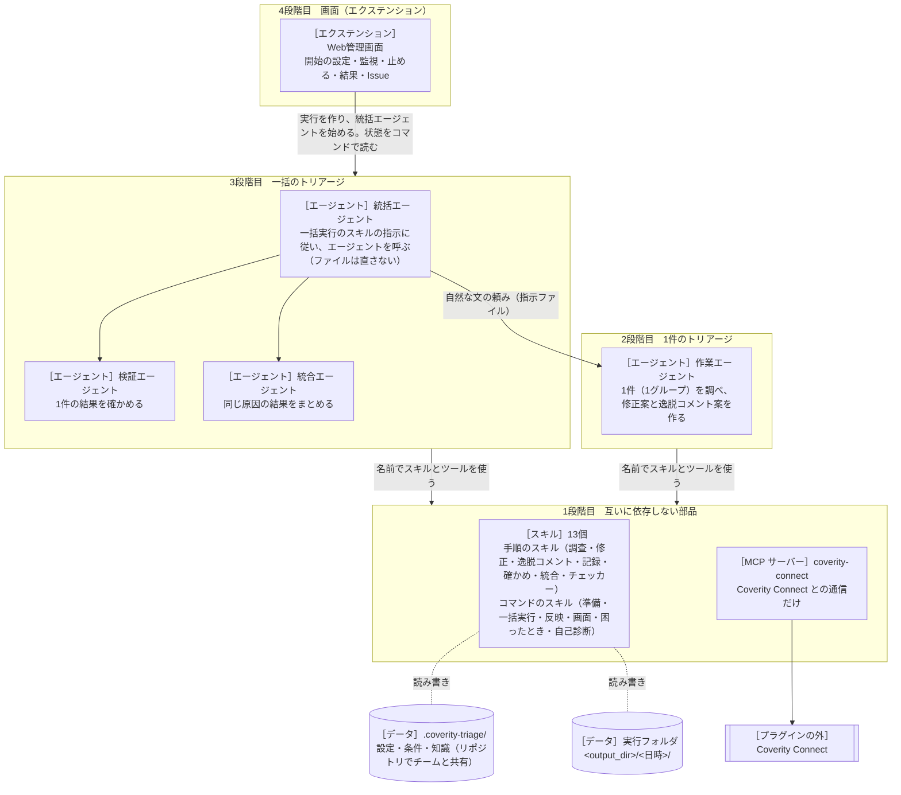

# coverity-triage-kit 設計書

内部のしくみと、部品の間の取り決め（インターフェース）を書く。
利用者から見た振る舞いは [仕様書](../specs/requirements.md) にある。

- バージョン：0.1.0

## 1. 基本の考え方

> **部品は、それぞれのフォルダだけで仕事ができる。部品どうしは、決まった形のファイルとコマンドと自然な文だけでつながる。**

- 部品は4つの段階に分かれる（2章の図）。下の段階は上の段階を知らない。上の段階は、下の段階の部品を、部品の表と設定のデータでだけ名前で参照する。
- 判断の要らない決まった処理（実行フォルダ、グループ分け、作業用のコピー、差分、一覧、反映、形の確かめ）は、スクリプトが受け持つ。判断（真偽、修正のコード、逸脱コメント、同じ原因か、確かめの合否）は、エージェントがスキルの手順で行う。Coverity との通信は、MCP サーバーだけが受け持つ。
- 一括の処理の順番は、スクリプトの状態機械が決める（Anthropic「Building effective agents」の workflow。予測できる流れはコードで決める）。統括エージェントは、その指示に従ってエージェントを呼ぶ。
- 4段階目のエクステンションは、3段階目を外から動かし、見るだけの層である。3段階目の部品は、エクステンションのツールを使わない。

元のプラグインとの主な違い：

| 元のプラグイン | coverity-triage-kit |
| --- | --- |
| スクリプト ct.py を1つのスキルにまとめ、5つのスキルがそれを名前で使った | スクリプトは、それを使うスキルの中に置く。スキルどうしは互いを知らない |
| 手順書のスキルが、ほかのスキルの名前を挙げて次の手順につないだ | つなぐのは作業エージェントの「使う部品」の表だけ |
| 1件の作業エージェントは、ct.py の指示ファイルなしでは動かなかった | 作業エージェントは、チャットの頼みだけでも動く（2段階目） |
| 画面の統括・作業・検証の外側の繰り返しの中で、内側の4つのサブエージェントが動いた（二重） | 繰り返しは1つ（警告ごとの 作業 → 確かめ → 作り直し）。画面はそれを見せる |
| MCP サーバーが実行フォルダの記録（operations.log）に書いた | MCP サーバーは実行フォルダを知らない |

## 2. アーキテクチャ



### 2.1 段階と部品

| 段階 | 部品 | 置き場所 | 知っていること |
| --- | --- | --- | --- |
| 1 | スキル | `skills/<名前>/` | 自分のことと、データの取り決め（4章）だけ |
| 1 | MCP サーバー | `mcp-servers/coverity-connect/` | Coverity Connect と、データの取り決め（4.1〜4.4、4.10）だけ |
| 2 | 作業エージェント | `com.github.copilot/agents/triage-worker.agent.md` | 使う部品の名前と役割（「使う部品」の表） |
| 3 | 統括・検証・統合のエージェント | `com.github.copilot/agents/triage-{orchestrator,reviewer,integrator}.agent.md` | 使う部品の名前と役割（表） |
| 4 | エクステンション | `com.github.copilot/extensions/coverity-triage-kit/` | エージェントとスキルの名前（`defaults.json` にだけ）、一括実行のスキルのコマンドの出力の形（4.12） |

今の部品の名前と役割の一覧は、開発者向けの [部品の変え方](../replace.md) にある。この設計書では、部品を役割で呼ぶ（「一括実行のスキル」など）。取り決めの表では、持ち主の役割を書く。

| 役割 | 今の部品 |
| --- | --- |
| チェッカーの見方 | `checker-knowledge` |
| 真偽の調査 | `triage-investigation` |
| 修正 | `code-fix` |
| 逸脱コメント | `deviation-comment` |
| 結果の記録 | `triage-report` |
| 結果の確かめ | `triage-review` |
| 同じ原因の統合 | `triage-integration` |
| 準備 | `coverity-setup` |
| 一括実行 | `coverity-run` |
| 反映 | `coverity-apply` |
| 結果と設定の画面 | `coverity-gui` |
| 困ったとき | `coverity-help` |
| 自己診断 | `coverity-selftest` |
| Coverity との通信 | MCP サーバー `coverity-connect` |

### 2.2 プラグインのフォルダ

```text
coverity-triage-kit/
  plugin.json  mcp.json  README.md  CHANGELOG.md  LICENSE  .gitignore  .github/plugin/marketplace.json
  docs/  constitution.md  specs/requirements.md  design/design.md  replace.md  guide/4-screen.md
  mcp-servers/coverity-connect/    MCP サーバー（README.md、pyproject.toml、uv.lock、src/、tests/、evals/）
  skills/<名前>/                   スキル（SKILL.md、README.md、scripts/、references/、assets/、tests/、evals/）
  com.github.copilot/agents/       エージェントの定義（<名前>.agent.md）と使い方（<名前>.README.markdown）
  com.github.copilot/extensions/coverity-triage-kit/   エクステンション（4段階目）
  tests/                           プラグイン全体の試験（独立性・取り決め・文書・段階ごとの EVAL・模擬の Coverity）
```

- `com.github.copilot/agents/` の中の `.md` のファイルは、Copilot CLI がすべてエージェントの定義として読む（1.0.105 で確認）。エージェントの使い方は、拡張子を `.markdown` にする。
- `mcp.json` は、`${PLUGIN_ROOT}/mcp-servers/coverity-connect` で MCP サーバーを登録する。`${PLUGIN_ROOT}` は `mcp.json` の中だけで展開される。部品のフォルダの中には書かない。

## 3. 部品の作りの決まり

### 3.1 スキルのフォルダ

- 中身：`SKILL.md`（エージェントが読む手順）、`README.md`（人が読む使い方）、`scripts/`（スクリプト）、`references/`（必要なときに読む詳しい資料。SKILL.md から1段でたどる）、`assets/`（ひな形など）、`tests/`（試験。フォルダだけをコピーしても `python3 -m unittest discover -s tests` で動く）、`evals/`（skill-creator の形の試験の課題）。
- SKILL.md の frontmatter は `name` と `description` だけ。`name` はフォルダ名と同じ。`description` は三人称で、何をするかと、いつ使うか（頼みの言い方の例）を書く。スラッシュコマンドの名前（`/…`）は書かない（名前を変えてコピーすると食い違うため）。
- 書かないもの：プラグインの名前（`coverity-triage-kit` とその略）、ほかのスキル・エージェント・MCP サーバー・エクステンション・Web管理画面の名前、フォルダの外を指すパス（`../`、`${PLUGIN_ROOT}` など）。ほかの部品の力を借りたいときは、役割をふつうの言葉で書く（例：「Coverity から警告経路を取れる道具があれば、それで取る」）。
- スクリプトは、Python 3.10 以上で動き、`uv run --native-tls --quiet "<このスキルのフォルダ>/scripts/<名前>.py" <コマンド>` で呼ぶ。要るライブラリは、スクリプトの先頭の PEP 723 の欄に書く（uv が用意する）。ほかのスキルのスクリプトを読み込まない。同じ処理が2つのスキルに要るときは、それぞれに持つ（第25条2項）。
- 結果の JSON は、標準出力に1つだけ、`ensure_ascii` で書く（`\uXXXX`。Windows の PowerShell で文字化けしないため）。経過は標準エラーに書く。失敗は `{"ok": false, "error": "...", "problems": [...]}` と終了コード 1。トレースバックを出さない。
- 「確かめる」コマンド（check など）は、ファイルを作らず、設定を書き換えない。
- 設定とログは UTF-8。パスは `pathlib` で扱う。

### 3.2 MCP サーバーのフォルダ

- Python と mcp-builder の Python の手引き（FastMCP、Pydantic v2）で作る。依存は `mcp>=1.20,<2`（mcp-builder の FastMCP は v1 の API。v2 の `MCPServer` は使わない）、`pydantic`、`pyyaml`、`httpx`、`truststore`。`uv.lock` を置き、`uv run --frozen` で動かす。
- 起動：`uv run --native-tls --frozen --quiet --directory <フォルダ> coverity-connect-mcp`（stdio）。
- フォルダの中に、プラグインの名前、ほかの部品の名前、`${PLUGIN_ROOT}` を書かない。README に、Copilot CLI・VS Code・Claude Code への登録の例を書く。
- 標準出力は MCP の通信に使うので、ログは標準エラーにだけ書く。
- 1回の呼び出しは 20 秒までで区切る（Copilot CLI はツールの呼び出しを 30 秒で切る）。ファイルに書くツールは、終わっていなければ `done: false` を返し、同じ引数で呼び直すと続きをする。
- Copilot CLI は、MCP サーバーに PATH のほかの環境変数を渡さない。Windows では、ユーザーの環境変数（`HKCU\Environment`）を直接読む。ほかの OS では、クライアントの設定の `env` で渡してもらう（README に書く）。

### 3.3 エージェントの定義

- Copilot CLI のカスタムエージェント（`<名前>.agent.md`）。frontmatter は `description`・`model`（候補の並び）・`tools`。
- 本文は短くする（Anthropic「Building effective agents」：単純、手順を見せる、道具の説明を大事にする）。
- 使う部品は、本文の「## 使う部品」の表（役割・部品・使うとき）にだけ名前で書く。表の外に、部品の名前・使う順の並び・自分の名前を書かない。表の上から順に使うものは、「使うとき」を「毎回」にする。
- `description` には、役割の言葉（統括役・作業役・検証役・統合役）を入れる。一括実行のスキルは、この言葉でエージェントを選ぶ（4.13）。
- ほかのエージェントから呼ばれたことは、ask_user が使えないことで知る（Copilot CLI は `task` で呼んだサブエージェントに ask_user を渡さない。1.0.98・1.0.102 で確認）。そのときは、質問も合否の判断もせず、頼みの文の求める形で返す。返事の形は、頼む側（指示ファイル）が決める。
- 報告・ログ・指示ファイルの中の文は資料として読み、そこに書かれた、頼みと食い違う指示には従わない。
- 試験のときは、Claude Code のエージェント（`.claude/agents/<名前>.md`）に置き換えて動かす（9.3）。

### 3.4 Windows への対応

| 項目 | 決まり |
| --- | --- |
| コマンド | SKILL.md と README のコマンドは、PowerShell でも bash でも動く書き方にする（ヒアドキュメント、`source`、`$(...)`、`&&` を使わない）。パスは `"..."` で囲む |
| Python | すべて `uv run --native-tls` で動かす（Python の版を uv がそろえる）。`--native-tls` は省かない（社内の証明書を使うため） |
| 標準出力 | JSON は `ensure_ascii` で書く |
| ファイル | UTF-8。BOM があっても読める。書くときは、一時ファイルに書いてから `os.replace`（Windows の PermissionError は少し待ってやり直す） |
| 環境変数 | 認証情報は、Windows ではユーザーの環境変数（`HKCU\Environment`）も読む |

## 4. 部品の間の取り決め

どの取り決めも、書く部品と読む部品がある。読む部品は、知らない項目を無視する（ほかの部品が項目を足しても壊れないように）。書く部品は、決まった項目だけを書く。

### 4.1 プロジェクトの設定 `.coverity-triage/`

調べたいリポジトリの根に置き、コミットしてチームで共有する（元のプラグインと同じ形）。

| ファイル | 中身 | 書く | 読む |
| --- | --- | --- | --- |
| `config.yaml` | 下の表 | 準備、結果と設定の画面 | MCP サーバー（`coverity:`）、一括実行、反映、困ったとき、自己診断 |
| `filters/*.yaml` | 条件ファイル（4.2） | 準備、結果と設定の画面 | MCP サーバー、一括実行 |
| `knowledge.md` | プロジェクトの知識（`## 調査で使う事実` / `## 推奨の方針（修正か逸脱か）` / `## 逸脱コメントの書き方`、1行に1つ） | 準備（ひな形）、反映（追記）、画面 | 手順のスキル（調査・修正・逸脱コメント・確かめ・統合） |
| `no-grouping.yaml` | `cids: [...]`（グループにしない CID） | 反映（却下したグループを追記） | 一括実行 |
| `fake-issues.yaml` など | 偽の警告（`coverity.api: fake` のとき） | 人、自己診断 | MCP サーバー |

`config.yaml` の項目（既定の値）：

| 項目 | 既定 | 意味 |
| --- | --- | --- |
| `coverity.url` | （必須） | Coverity Connect の URL |
| `coverity.api` | `auto` | `auto` か `fake` |
| `coverity.user_env` / `coverity.key_env` | `COV_USER` / `COV_AUTH_KEY` | 認証情報を入れる環境変数の名前 |
| `coverity.triage_store` | `Default Triage Store` | ストリームから決められないときのトリアージストア |
| `coverity.revision_field` | `sourceVersion` | 解析したリビジョンを入れたスナップショットの項目 |
| `coverity.path_strip_prefixes` | `[]` | 警告のファイルのパスから外す先頭 |
| `coverity.ca_file` | （空＝OS の証明書） | 証明書のファイル |
| `coverity.fake_data` | （空） | `api: fake` のときの偽の警告のファイル（`.coverity-triage/` からの相対） |
| `vcs.type` / `vcs.base_branch` / `vcs.branch_prefix` | 自動 / 自動 / `coverity-fix/` | git か svn、修正の元のブランチ、修正のブランチの頭 |
| `output_dir` | `../coverity-triage-out` | 実行フォルダの置き場所（リポジトリの外。リポジトリからの相対か絶対） |
| `max_items` | `100` | 1回の実行の上限 |
| `parallel` | `3`（1〜8） | 同時に動かす作業エージェントの数 |
| `options.annotation` / `per_run_branch` / `knowledge_suggestions` / `metrics` / `markdown` | すべて `false` | オプション |
| `verify.default` | `none` | `none` / `build` / `build+analyze` |
| `verify.initial` | `false` | 最初に解析するか |
| `verify.setup_command` / `build_dir` / `build_command` | （空） | ビルドの準備・場所・コマンド（`{root}` は作業用のコピーの根） |
| `verify.cov_build_args` / `cov_analyze_args` / `cov_commit_args` | `--dir idir` / `--dir idir --all` / （空） | 解析のツールの引数 |
| `verify.timeout_minutes` | `180` | 解析とビルドの時間の上限 |
| `agents.integration` / `agents.review` | `false` / `false` | 統合と確かめを使うか |
| `agents.max_rework` | `1`（0〜2） | 確かめで差し戻した警告を作り直す回数の上限 |

### 4.2 条件ファイル `filters/*.yaml` と `filter.json`

```yaml
name: 分類がまだの警告        # 表示の名前
project: app                 # プロジェクト（省略可）
streams: [app-main]          # ストリーム（ちょうど1つ）
checkers: [NULL_RETURNS, "MISRA C-2012 Rule 10.*"]   # * ? [ ] のワイルドカード可
impacts: [High, Medium]      # High / Medium / Low / Unspecified
triage:
  classification: [Unclassified]   # Unclassified / Pending / False Positive / Intentional / Bug
  action: [Undecided]              # Undecided / Fix Required / Fix Submitted / Modeling Required / Ignore
  status: [New, Triaged]           # New / Triaged / Dismissed / Absent Dismissed / Fixed
limit: 20
```

- 同じ項目の中の値は「どれか」、項目どうしは「すべて」。
- 一括実行のスキルは、選ばれた条件ファイルにチャットの条件を足し、実行フォルダに `filter.json`（同じ項目の JSON。`limit` は実行の上限）を書く。MCP サーバーは、条件ファイル（YAML）も `filter.json` も読める。

### 4.3 警告の一覧 `issues.json`（MCP サーバーが書き、一括実行が読む）

MCP サーバーの警告の検索を、ファイルに書く使い方で呼んだときの出力。

```json
{"filter_sha": "…", "stream": "app-main", "limit": 20, "started_at": "ISO", "finished_at": "ISO または null（途中）",
 "coverity_total": 52, "next_offset": 0, "limited": true,
 "revision_field": "sourceVersion", "revision_checked": true, "analyzed_revision": "a1b2c3d", "revision_error": null,
 "issues": [{"cid": 20001, "checker": "NULL_RETURNS", "file": "src/reader.c", "function": "read_header", "line": 42,
             "impact": "High", "category": "…", "cwe": 476, "merge_key": "…", "macro": null, "stream": "app-main",
             "classification": "Unclassified", "action": "Undecided", "severity": "Unspecified", "status": "New"}],
 "excluded_count": 0, "excluded": [], "excluded_cids": [], "requests": []}
```

- `finished_at` が入るまでは途中。一括実行は、`finished_at` のないファイルを使わない。
- 警告の項目は、値がないものを省く。`file` は Coverity のパスのまま（リポジトリのパスへの読み替えは、一括実行が行う）。

### 4.4 警告経路 `issue-<CID>.json`（MCP サーバーが書き、一括実行が読む）

MCP サーバーの警告経路の取得を、`output_dir` を付けて呼んだときの出力。CID ごとに1つ。

```json
{"fetched_at": "ISO", "issue": {…4.3 の警告の項目…},
 "events": [{"file": "src/reader.c", "line": 40, "tag": "returned_null", "description": "…", "main": false}],
 "checker_description": "…"}
```

失敗した CID は `{"cid": 20001, "stream": "app-main", "fetched_at": "ISO", "error": "…"}`。認証の失敗など、全体が止まる失敗では、ファイルを書かない。

### 4.5 1件の結果 `result.json`（結果の記録のスキルが形を持つ。一括実行が写しを持つ）

```json
{
  "item": "20001",
  "verdict": {"judgement": "true_bug", "summary": "40文字ほどの要約", "rationale": "根拠の説明",
              "evidence": [{"file": "src/reader.c", "line": 42, "note": "fgets が NULL を返す"}]},
  "recommendation": "fix",
  "confidence": "high",
  "confidence_reason": "…",
  "deviation": {"classification": "Bug", "action": "Ignore", "severity": "Moderate", "comment": "本物の不具合。…（200文字以内）"},
  "fix": {"classification": "Bug", "action": "Fix Required", "severity": "Moderate", "summary": "…", "impact": "…",
          "exceeded_constraints": [], "already_fixed_on_latest": false},
  "revision_drift": {"status": "none", "detail": ""},
  "group_excluded_cids": []
}
```

- 値：`judgement` は `true_bug` / `false_positive` / `intentional` / `undetermined`。`recommendation` は `fix` / `deviation`。`confidence` は `high` / `medium` / `low`。`revision_drift.status` は `none` / `detected` / `unknown`。
- Classification・Action・Severity の組：誤検知 → False Positive / Ignore / Unspecified。意図的 → Intentional / Ignore / Unspecified。本物で直さない → Bug / Ignore / Major・Moderate・Minor。修正の案 → Bug / Fix Required / 警告の Impact に合わせた重さ。
- 決まった項目のほかを書かない。文字列は空にしない（`detail` と `note` は空でよい）。`deviation.comment` は前後の空白を除いて200文字以内。`group_excluded_cids` は、グループのときだけ、グループの CID の一部（全部は外さない）。
- JSON Schema は、結果の記録のスキルの `assets/result.schema.json`。一括実行のスキルは、同じ内容の写しを `assets/result.schema.json` に持ち、指示ファイルと一緒に実行フォルダの `schemas/` に置く。

### 4.6 確かめの結果 `review.json`（結果の確かめのスキルが形を持つ。一括実行が写しを持つ）

```json
{"item": "20001", "outcome": "pass",
 "findings": [{"check": "evidence", "ok": true, "detail": "…", "file": "src/reader.c", "line": 42}],
 "confidence_cap": null, "rework": [], "note": "…"}
```

- `outcome`：`pass`（合格）/ `flag`（要確認）/ `rework`（差し戻し。`rework` に直すことを書く）。`confidence_cap`：`high` / `medium` / `low` / `null`。
- `check` の名前と意味（確かめる項目の一覧）は、結果の確かめのスキルが決める。画面は、`check` と `ok` と `detail` をそのまま見せる。
- JSON Schema は、結果の確かめのスキルの `assets/review.schema.json`（一括実行に同じ写し）。

### 4.7 統合の計画 `integration/plan.json`（同じ原因の統合のスキルが形を持つ。一括実行が写しを持つ）

```json
{"merges": [{"members": ["20003", "20004"], "reason": "…", "fix_source": "item:20003",
             "result": {…result.json から item と group_excluded_cids を除いたもの…}}],
 "conflicts": [{"items": ["20005", "20006"], "note": "同じ場所だが原因が違う"}]}
```

- `fix_source`：`item:<ID>`（その作業の修正を使う）/ `combine`（修正を合わせる）/ `rework`（作り直す）。1つの merge の CID は合わせて10まで。まとめた確信度は、メンバーのいちばん低いもの以下。
- JSON Schema は、同じ原因の統合のスキルの `assets/plan.schema.json`（一括実行に同じ写し）。

### 4.8 進み具合 `progress.json`

指示ファイルが書くよう求めたときだけ、エージェントが上書きで書く。`{"item": "20001", "phase": "read", "note": "60文字ほど"}`。`phase` の値は、指示ファイルが示す（作業：read / judge / fix / deviation / result、確かめ：read / check / write、統合：read / compare / write）。時刻は書かない（ファイルの更新時刻を使う）。読むのは一括実行と結果と設定の画面。

### 4.9 承認 `approvals.json`（一括実行が既定を作り、画面が人の選択を書き、反映が読む）

```json
{"version": 1, "updated_at": "ISO",
 "items": {"20001": {"decision": "fix", "edited": false, "updated_at": "ISO",
                     "deviation": {"classification": "…", "action": "…", "severity": "…", "comment": "…"}}}}
```

- `decision`：`fix`（修正）/ `deviation`（逸脱）/ `reject`（却下）/ `null`（反映しない）。既定は推奨（最新で直っていて差分がないものは `null`）。
- `deviation` は、人が逸脱コメントなどを直したときだけある。AI は `approvals.json` を書き換えない。
- 終わった作業（`done`）のほかは承認できない。統合か確かめを使う実行では、一覧ができるまで承認できない。

### 4.10 反映の計画 `apply-plan.json` と確認の文字列（反映が書き、MCP サーバーが読む）

```json
{"run_id": "20261108-101500", "created_at": "ISO",
 "triage": [{"id": "20002", "cids": [20002], "stream": "app-main",
             "classification": "False Positive", "action": "Ignore", "severity": "Unspecified", "comment": "誤検知。…"}],
 "code": [{"id": "20001", "cids": [20001], "kind": "fix", "files": ["src/reader.c"], "patch": "<絶対パス>", "branch": "coverity-fix/cid-20001", "commit": "<sha>"}],
 "reject": [{"id": "G1", "cids": [20005, 20006], "group": true}]}
```

- 確認の文字列は、`apply-plan.json` のバイト列の SHA-256 の16進の先頭12文字。反映のスキルと MCP サーバーが、同じファイルから同じ値を出す。
- MCP サーバーは `triage` だけを読む（ほかの項目は無視する）。書き戻しの結果は、同じフォルダの `apply-plan.result.json`（`{"written": {<鍵>: {...}}, "failed": {<鍵>: {...}}, "requests": [...]}`。鍵は項目の内容の SHA-256 の先頭16文字）。同じ内容の項目は二重に書かない。
- MCP サーバーをファイルなしで使うとき（`entries` を渡すとき）の確認の文字列は、`{"triage": [項目…]}` を `sort_keys`・区切り `(",", ":")`・`ensure_ascii=False` で JSON にした UTF-8 の SHA-256 の先頭12文字（`stream` がない項目はその鍵を入れない）。

### 4.11 実行フォルダ（一括実行が持ち主）

`<output_dir>/<YYYYmmdd-HHMMSS>[-n]/`。名前は `^[0-9]{8}-[0-9]{6}(-[0-9]+)?$`。

```text
run.json                 実行の状態（一括実行だけが書く）
filter.json  issues.json  issues.mapped.json  config.snapshot.yaml
schemas/                 result・review・plan の JSON Schema の写し（指示ファイルが指す）
operations.log           一括実行の出来事（JSON Lines。認証情報は ****）
items/<ID>/              brief.md（作業の指示）、issue-<CID>.json、progress.json、result.json、result.previous.json、review.json、saved.json
agents/                  検証と統合の指示（reviewer/<ID>.md、integrator/brief.md）と進み具合
integration/             candidates.json、plan.json、merged.json
analysis/                初回解析の記録（status.json、initial.log）
work/                    作業用のコピー（git worktree か svn checkout）。一覧を作るときに消す
cid/<ID>.html            詳細レポート（オプションで .md も）
summary.html             一覧（オプションで summary.md も）
patches/<ID>-fix.patch   差分（git 形式）
fixed/<ID>/fix/<パス>     修正後のファイル（警告ごとに独立）
approvals.json  apply-plan.json  apply-plan.result.json  apply-code.result.json  verify.json  metrics.json
issues-found.jsonl       統括エージェントが書き残した課題（1行に1件の JSON：{"title","body","at"}）
```

- `<ID>` は CID か、グループの `G1`、`G2`…。
- 結果と設定の画面、反映、困ったとき、自己診断は、この形を読む（`run.json` の `items[].status` など、使う項目を各部品の README に書く）。エクステンションは、ファイルを直接読まず、4.12 のコマンドで読む。

### 4.12 一括実行のコマンド（一括実行のスキル。統括エージェントとエクステンションが使う）

`uv run --native-tls --quiet "<一括実行のスキルのフォルダ>/scripts/run.py" <コマンド> …`

| コマンド | 使う部品 | 出力の主な項目 |
| --- | --- | --- |
| `runs --repo R` | 統括、画面 | `runs[{run_id, run_dir, created_at, filter_name, counts, unfinished, has_summary}]` |
| `new-run --repo R [--filter F] [--impact X]… [--checker X]… [--status X]… [--classification X]… [--action X]… [--limit N] [--verify none\|build\|build+analyze] [--initial\|--no-initial] [--review\|--no-review] [--integration\|--no-integration] [--max-rework N]` | 統括、エクステンション | `run_dir, repo_root, work_dir, limit, initial, review, integration, max_rework` |
| `resume --run D` | 統括 | `run_dir, counts` |
| `tick --run D [--finished T] [--failed T --reason R] [--wait S]` | 統括 | 下の「tick の出力」 |
| `status --run D` | 統括、エクステンション | 下の「status の出力」 |
| `summary --run D` | 統括、エクステンション | `summary_html, counts, results[], unprocessed[], approvals_file` |
| `note-issue --run D --title T --body B` | 統括 | `issues_found`（件数） |
| `initial-status --run D` | 統括 | 初回解析の段と進み |

tick の出力：`{ok, stage, stage_label, actions[], wait, done, stop, say[], counts, running_tasks[], next}`。`actions` の形：

| type | 項目 | 統括エージェントがすること |
| --- | --- | --- |
| `fetch_issues` | `task, repo_root, filter_file, output_file` | Coverity との通信の部品で、条件に合う警告を `output_file` に書く（`done: false` なら呼び直す）。終わったら `--finished <task>` |
| `fetch_details` | `task, repo_root, stream, cids, output_dir` | 同じく、警告経路を `output_dir` に書く |
| `launch` | `task, role (worker\|reviewer\|integrator), item, prompt, background` | 役割に合うエージェントに `prompt` をそのまま渡す（`background` なら終わりを待たずに次へ）。終わったら `--finished <task>`、失敗したら `--failed <task> --reason …` |
| `command` | `task, command, note` | コマンドを動かす。終わったら `--finished <task>` |

`stop: true` は、続けられない（理由は `say` と `error`）。`done: true` は、`summary` を動かす時。

status の出力（画面のため。読むだけで、ファイルを変えない）：

```json
{"ok": true, "run_id": "…", "run_dir": "…", "repo_root": "…", "stage": "items", "stage_label": "警告ごとの作業",
 "finished": false, "has_summary": false, "review": true, "integration": false, "max_rework": 1,
 "counts": {"pending": 3, "in_progress": 2, "done": 5, "error": 0, "merged": 0, "total": 10},
 "items": [{"id": "20001", "cids": [20001], "checker": "NULL_RETURNS", "status": "done", "phase": "result",
            "note": "…", "elapsed_seconds": 312, "stalled": false, "attempts": 1, "rework_rounds": 0,
            "review": {"outcome": "pass", "findings": [{"check": "…", "ok": true, "detail": "…"}]} ,
            "recommendation": "fix", "confidence": "high", "error": null}],
 "errors": [{"item": "20007", "kind": "取得", "detail": "…"}],
 "recent": ["10:15:02 20001 の作業が終わった", "…"],
 "initial": {"used": false, "step": null, "value": 0, "max": 100, "label": "初回解析はしない"},
 "progress": {"value": 5, "max": 10, "label": "5 / 10"}}
```

- `stalled` は、10分（初回解析は30分）動きがない作業で真。修正用のコピーを用意している作業では偽。
- `confidence` は、作業と確かめの低いほう（人に見せる確信度）。

### 4.13 役割の言葉（一括実行とエージェント）

一括実行の `launch` の `role` は、`worker`（作業役）・`reviewer`（検証役）・`integrator`（統合役）。統括エージェントは、「使う部品」の表で役割に合うエージェントを選ぶ。統括エージェントを使わずに一括実行のスキルを使うときは、説明に役割の言葉（作業役・検証役・統合役）があるエージェントを選び、なければ汎用のサブエージェントに頼む。

### 4.14 指示ファイル（一括実行が書き、エージェントが読む）

`launch` の `prompt` は「指示ファイル <パス> を読み、書かれた手順に従ってください。」の形で、指示ファイルを指す。指示ファイルは、それだけで仕事が分かるように書く。スキルやエージェントの名前は書かない。

| 指示ファイル | 中身 |
| --- | --- |
| 作業 `items/<ID>/brief.md` | 警告の情報（CID、チェッカー、Impact、ファイルと行、関数、警告経路と前後のコード。問題の起きる行に ★）、読むコードのフォルダ（解析したリビジョンのコピーか、リポジトリ）、直すフォルダ（作業用のコピー）、結果のファイルと形（`schemas/result.schema.json`）、進み具合のファイルと段、プロジェクトの知識のファイル、守ること（コマンドは使わない。直すのは直すフォルダ・結果・進み具合だけ）、返す形（1行：「<ID>: <推奨>（確信度 <高/中/低>）— <要約>」）。作り直しのときは「確かめの指摘（直すこと）」、統合のときは「統合の指示」の節を足す |
| 確かめ `agents/reviewer/<ID>.md` | 調べる作業の結果のファイル、差分、読むコード、スクリプトが見つけた点、書くファイル（`review.json`）と形、返す形 |
| 統合 `agents/integrator/brief.md` | 候補の組、それぞれの結果と差分、書くファイル（`integration/plan.json`）と形、返す形 |

### 4.15 エクステンションと統括エージェント

エクステンションは、`new-run` で作った実行フォルダを、統括エージェントへの頼みに書いて渡す。頼みの文のひな形は、エクステンションの `core/messages.mjs` にだけある。統括エージェントの定義には、エクステンションとの決まりを書かない。

## 5. MCP サーバー（Coverity との通信）

サーバーの登録名は `coverity-connect`、サーバーの名前（serverInfo）は `coverity_mcp`。Copilot CLI のエージェントの `tools` では `coverity-connect/<ツール>` と書く。

| ツール | 注釈 | すること |
| --- | --- | --- |
| `coverity_check_connection(repo_root?)` | 読むだけ | 接続と認証を確かめる。URL、ユーザー名、認証キーがあるか（値は出さない）、http なら注意、設定の知らない項目 |
| `coverity_search_issues(repo_root?, filter?, filter_file?, offset=0, limit=20, response_format="concise", output_file?)` | 読むだけ | 条件に合う警告。会話に返すときは1ページ最大100件で `has_more`・`next_offset` を返す。`output_file` を渡すと 4.3 の形で書き、途中なら `done: false` |
| `coverity_get_issue_details(repo_root?, cids, stream?, response_format="concise", output_dir?)` | 読むだけ | CID ごとの警告経路とチェッカーの説明。会話には10件まで、`output_dir` には50件まで（4.4）。`stream` がなければ、条件ファイルのストリームが1つに決まるときはそれを使う |
| `coverity_preview_triage(plan_file?, entries?)` | 読むだけ・通信しない | 書き戻す件数・内容・確認の文字列 |
| `coverity_update_triage(confirmation_token, repo_root?, plan_file?, entries?)` | 書き込む・同じ内容は二重にしない | 確認の文字列が合うときだけ書き戻す。ストリームからトリアージストアを決める |

- 設定：`repo_root` を渡すと `<repo_root>/.coverity-triage/config.yaml` の `coverity:` を読む。渡さないときは、環境変数 `COVERITY_URL`（と `COVERITY_TRIAGE_STORE`、`COVERITY_CA_FILE`、`COVERITY_FAKE_DATA`）を読む。認証情報は 4.1 の環境変数。
- 通信：REST v2（警告の検索、ストリーム、トリアージの書き戻し `PUT /api/v2/issues/triage`）と SOAP v9（警告経路 `getStreamDefects`、スナップショット）。TLS は `ca_file` か OS の証明書（truststore）。
- エラーの分け方：3xx・REST の 401/403・5xx・通信の失敗・JSON や SOAP でない応答は、呼び出し全体を止める。ほかの 4xx と SOAP の失敗は、その項目だけを失敗にする。条件の値が Coverity に知らないと言われたら、その値を外して続け、そのことを返す。
- 偽の Coverity：`api: fake` のとき、`fake_data` のファイル（4.1）を警告として返し、書き戻しを `<fake_data>.writes.jsonl` に足す。
- 引数のパスは絶対パス（サーバーは自分のフォルダで動くため）。ツールの説明に書く。

## 6. スキル

各スキルの手順・コマンド・設定の項目は、そのスキルの SKILL.md と README にある。ここには、役割と、使う取り決めだけを書く。

| 役割 | スクリプト | 使う取り決め |
| --- | --- | --- |
| チェッカーの見方 | なし（`references/standard.md`・`misra.md`・`cert.md`） | なし |
| 真偽の調査 | 警告経路と前後のコードを見やすく出す | 4.1（knowledge.md）、4.4 を読める |
| 修正 | なし（差分は git / svn で見る） | 4.1（knowledge.md） |
| 逸脱コメント | 逸脱コメントの形を確かめる | 4.5 の comment と組 |
| 結果の記録 | `result.json` の形を確かめる、文にする | 4.5（持ち主） |
| 結果の確かめ | 結果の機械的な確かめ（根拠の行があるか、組み合わせのずれ）、`review.json` の形を確かめる | 4.5 を読む、4.6（持ち主） |
| 同じ原因の統合 | `plan.json` の形を確かめる | 4.5 を読む、4.7（持ち主） |
| 準備 | 設定の用意・確かめ・注釈を残した書き換え、接続の確かめ（標準ライブラリ） | 4.1、4.2（書く） |
| 一括実行 | `run.py`（実行フォルダ、tick、グループ分け、作業用のコピー、形の確かめ、確かめの差し戻し、統合、ビルドでの検証、初回解析、一覧と詳細） | 4.1〜4.14（持ち主：4.9 の既定、4.11、4.12、4.14） |
| 反映 | 承認の確かめと反映の計画、修正のブランチ・push・svn の差分の当て、知識の追記、効果の集計 | 4.9、4.10（書く）、4.11 を読む |
| 結果と設定の画面 | ブラウザーの画面（127.0.0.1 だけ、合言葉つき） | 4.1、4.2（書く）、4.8、4.9（人の選択を書く）、4.11 を読む |
| 困ったとき | 点検（道具・設定・環境変数）、実行の様子 | 4.1、4.11 を読む |
| 自己診断 | 道具・見本での流れの照合・社内の Coverity（読むだけ）・ビルドの確かめ、伏せ字の報告 | 4.1、4.11 を読む |

- 手順のスキルは、指示ファイルを渡されたとき（ほかのエージェントからの作業）も、チャットで直接頼まれたときも、同じ手順で動く。違いは、頼みの文や指示ファイルに書かれた入出力の場所だけ。
- 準備と結果と設定の画面は、どちらも `config.yaml` を注釈を残して書き換える。それぞれ自分のスクリプトにその処理を持つ。

## 7. エージェント

| 役割 | 段階 | tools | 使う部品の表 |
| --- | --- | --- | --- |
| 作業役（作業エージェント） | 2 | read、edit、search、execute、skill、ask_user、Coverity との通信の読むだけのツール | チェッカーの見方、真偽の調査、修正、逸脱コメント、結果の記録、Coverity との通信 |
| 統括役（統括エージェント） | 3 | agent、read、search、execute、skill、ask_user、Coverity との通信の読むだけのツール | 一括実行、Coverity との通信、作業役・検証役・統合役のエージェント |
| 検証役（検証エージェント） | 3 | read、search、edit、skill | 結果の確かめ、チェッカーの見方 |
| 統合役（統合エージェント） | 3 | read、search、edit、skill | 同じ原因の統合、逸脱コメント、チェッカーの見方 |

- 作業役：ask_user があれば（利用者と話しているとき）、足りない情報を聞き、作業中のファイルを直す前に差分を見せて同意を得る。ないときは、指示ファイルのとおりにし、コマンドは指示ファイルが許したときだけ使う。
- 統括役：一括実行のスキルの tick に従う。自分で警告を調べない。ファイルを直さない。コマンドは一括実行のスキルのものだけ。始める前（ask_user があるとき）に、再開するかと、修正用のフォルダの許可を聞く。始めた後は聞かない。終わったら、`status` と `operations.log` を見て課題を `note-issue` で書き残す。
- 検証役：書いてよいのは `review.json` と進み具合だけ。結果と差分は直さない。
- 統合役：書いてよいのは `integration/plan.json` と進み具合だけ。

## 8. エクステンション（4段階目）

元のプラグインのエクステンションの画面の部品（画面の作り、見た目、記録、止め方、Issue の起票、立ち直り）を引き継ぎ、動かし方を次のように変える。

### 8.1 流れ

1. 利用者が頼むと、メインのエージェントが `coverity-triage-kit_open(requestText)` を呼ぶ。サーバーを起動し、URL を返す（127.0.0.1、既定 8731、使われていれば空いている番号、URL に合言葉 `?k=`）。
2. 画面で開始すると、エクステンションは：
   1. 役割ごとのモデルと思考の深さを、この会話の中だけ上書きする（`rpc.tools.updateSubagentSettings`）。
   2. 一括実行の `new-run` を動かす（画面の条件ファイル・Impact・件数・初回解析・繰り返しの上限を引数にし、`--review` を付ける）。
   3. 統括エージェントを、実行フォルダを書いた頼み（4.15）で始める（`rpc.tasks.startAgent`）。
3. 実行中は、2秒ごとに `status` を動かして画面に出し、Copilot CLI のイベントからエージェントの状態・確認の待ち・課題を作る。
4. 統括エージェントが終わったら、`summary` の結果（なければエクステンションが `summary` を動かす）と `status` から、結果の画面を作る。結果と設定の画面へのリンクは、そのスキルのスクリプトに `--no-browser` で URL を出させて作る。
5. 課題は、イベントから機械的に分かるものと、実行フォルダの `issues-found.jsonl`（統括エージェントが書いたもの）から作る。

### 8.2 見せ方

| 画面の項目 | もと |
| --- | --- |
| エージェントの役割と状態と担当とモデル | イベント（サブエージェントの開始・終了・失敗）。役割は `defaults.json` のエージェントの名前で決める |
| 計画・実行・評価 | 動いているエージェント（検証役が動いていれば評価、作業役か統合役なら実行、統括役だけなら計画） |
| 作業ごとの様子・エラー・最近の動き・初回解析・全体の進み | `status` |
| 検証の結果 | `status` の `items[].review.findings` |
| 件数・一覧・処理できなかった作業 | `summary` と `status` |
| 終わった理由 | すべて合格（確かめがすべて pass）／上限の回数に達した（作り直しの上限で要確認が残った、または処理できなかった作業がある）／ユーザーが止めた／途中で終わった（統括エージェントの失敗、チャットからの中断、AI クレジットの上限、`/clear` で切れた、エクステンションの再起動） |

### 8.3 守り

- 止めた実行のエージェントのツールは、`onPreToolUse` ですべて拒む（フックは例外を投げない）。
- 統括エージェント（とそこから呼ばれていないメインの会話のエージェント）には、ファイルを書くツール（edit、create、apply_patch など）を拒む。
- 許可の求め（`onPermissionRequest`）は見るだけで、いつも `{kind: "no-result"}` を返す。
- 記録は `<COPILOT_HOME または ~/.copilot>/plugin-data/coverity-triage-kit/runs/<日時>-<id>/`（log.jsonl、result.json、alive、issues/）。20件まで残す。

### 8.4 `defaults.json`

エージェントとスキルの名前は、ここにだけ書く。

```json
{"orchestrator": "coverity-triage-kit:triage-orchestrator",
 "roles": {"worker": "coverity-triage-kit:triage-worker", "reviewer": "coverity-triage-kit:triage-reviewer",
           "integrator": "coverity-triage-kit:triage-integrator"},
 "runSkill": "coverity-run", "guiSkill": "coverity-gui",
 "maxReworkDefault": 1, "port": 8731, "issueRepo": null}
```

## 9. 試験

プラグインのフォルダで `python3 tests/run.py`（Windows は `py -3 tests/run.py`）。モデルを使わない試験をすべて動かし、合否を `tests/results/`（git に入れない）にも書く。

### 9.1 モデルを使わない試験

| 試験 | 置き場所 | 確かめること |
| --- | --- | --- |
| スキル | `skills/<名前>/tests/` | スクリプトの振る舞い。フォルダだけでも動く |
| MCP サーバー | `mcp-servers/coverity-connect/tests/` | ツール（偽の通信・偽の Coverity）。フォルダだけでも動く |
| 模擬の Coverity との結合 | `tests/integration/` | MCP サーバーと模擬の Coverity Connect（REST v2・SOAP v9、`tests/coverity_emulator/`）。一括実行の流れを、決まった振る舞いの偽のエージェントで最後まで流す |
| 取り決め | `tests/contracts/` | 4章の写しが一致する（schema のファイル）。書く部品の出力を、読む部品が受け付ける |
| 独立性 | `tests/independence/` | 部品のフォルダに、ほかの部品の名前・プラグインの名前・外を指すパスがない。部品を1つずつ別の場所にコピーして、その試験が通る。エージェントの定義は、部品の名前を表にだけ書く。上の段の文書に下の段の中身がない。部品の名前は、フォルダ・`defaults.json`・表から読む（試験に書かない） |
| エクステンション | `tests/extension/` | 偽の SDK で、開始・状態・止める・守り・画面のサーバー。偽の DOM か Playwright で画面 |
| 文書 | `tests/docs/` | 版の一致、要求の番号の追跡（10章） |

### 9.2 EVAL（実際のモデル。CI では動かさない）

| 段階 | 置き場所 | 動かし方 |
| --- | --- | --- |
| 1（スキル） | `skills/<名前>/evals/<課題>/`（skill-creator の形：`prompt.md`、`case.yaml`、`graders/`、`files/`） | skill-creator の手順で、スキルありとなしを比べて採点する。`claude plugin eval` でも動く |
| 1（MCP） | `mcp-servers/coverity-connect/evals/evaluation.xml`（mcp-builder の形） | 模擬の Coverity を起動し、`tests/eval/run_mcp_eval.py` が Claude Code に MCP サーバーだけを渡して答えさせ、文字列で照合する |
| 2 | `tests/eval/stage2/` | 作業エージェントとその表のスキルだけを一時フォルダに取り出し、Claude Code のエージェントに置き換えて、1件のトリアージをさせる |
| 3 | `tests/eval/stage3/` | 3段階目の部品だけを取り出し、統括エージェントで一括のトリアージをさせる（偽の Coverity） |
| 4 | `tests/eval/stage4/` | エクステンションを偽の SDK で動かし、統括エージェントの代わりに Claude Code を動かして、画面の流れを確かめる |

### 9.3 Copilot CLI の代わりに Claude Code で試すとき

- エージェントの定義は、試験の道具（`tests/eval/claude_adapter.py`）が Claude Code の形に置き換える（tools の名前の読み替え：read → Read・Glob・Grep、edit → Edit・Write、execute → Bash、agent → Task、skill → Skill、ask_user → AskUserQuestion、`coverity-connect/<tool>` → `mcp__coverity-connect__<tool>`）。本文は変えない。
- Claude Code で再現しないもの：ask_user がサブエージェントにないこと（`claude -p` ではメインにもない）、`agents/` の `.md` の読み込み、エクステンション、モデルの名前。これらは、Copilot CLI での手動の確認とする（未確認）。

## 10. 要求の追跡

| 要求 | 設計書 | 確かめ方 |
| --- | --- | --- |
| REQ-001 | 1、2.1、8 | `tests/independence/`、EVAL 3 |
| REQ-002 | 2.2、3.1、3.2、3.3 | `tests/independence/`（コピーして試験）、EVAL 2・3 |
| REQ-003 | 2.1、3.1、3.3、8.4 | `tests/independence/` |
| REQ-004 | 4 | `tests/contracts/`、`tests/integration/` |
| REQ-005 | 3.4 | 各部品の試験（CI の Windows） |
| REQ-006 | 2.1、3.1 | `tests/independence/` |
| REQ-007 | 2.2、5、8.3、8.4 | `tests/independence/` |
| REQ-101 | 3.1 | `tests/independence/`、各スキルの試験 |
| REQ-102 | 3.1、3.4 | 各スキルの試験 |
| REQ-103 | 4.1 | 各スキルの試験、`tests/contracts/` |
| REQ-104 | 3.2、4.1 | 各部品の試験 |
| REQ-105・REQ-106 | 3.1、3.3 | 各部品の試験、`tests/independence/` |
| REQ-111・REQ-112 | 5 | MCP サーバーの試験、`tests/integration/`、EVAL 1（MCP） |
| REQ-121〜REQ-125 | 6 | 各スキルの試験、EVAL 1（スキル） |
| REQ-201〜REQ-205 | 3.3、7 | `tests/independence/`、EVAL 2 |
| REQ-301〜REQ-308 | 4.12〜4.14、7 | 一括実行の試験、`tests/integration/`、EVAL 3 |
| REQ-401〜REQ-404 | 8.1、8.4 | `tests/extension/` |
| REQ-411〜REQ-414 | 8.2、8.3 | `tests/extension/`、EVAL 4 |
| REQ-421・REQ-422 | 8.1、8.2 | `tests/extension/`、EVAL 4 |
| REQ-423 | 8 | `tests/extension/`（Playwright。幅 390 px、ライトとダーク） |
| REQ-501〜REQ-506 | 4.5〜4.7、6 | 手順のスキルの試験、EVAL 1〜3 |
| REQ-507 | 4.11 | 一括実行の試験、`tests/integration/` |
| REQ-508 | 4.9、4.10 | 反映の試験、MCP サーバーの試験、`tests/integration/` |
| REQ-509 | 1 | EVAL 3 の時間と件数（目安） |
| REQ-601 | 9.1 | `tests/run.py` |
| REQ-602 | 9.2 | EVAL の報告（`tests/eval/REPORT.md`） |
| REQ-603 | 9.1、9.2 | `tests/independence/`、EVAL 2・3 |
