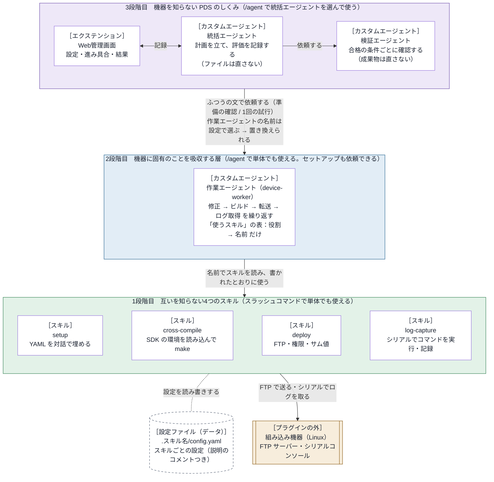

# embedded-debug-loop 設計書

この文書は、embedded-debug-loop の中のしくみと、部品の間の約束を書く。
利用者から見た振る舞いは [仕様書](../specs/requirements.md) にある。

- バージョン：0.3.0

## 1. 基本の考え方

> **組み込み機器に固有のことは、すべて2段階目の作業エージェントが吸収する。**

部品は、次の3つの段階に分かれる。

| 段階 | 部品 | 役目 |
| --- | --- | --- |
| 3段階目 | 統括エージェント（`orchestrator`）、検証エージェント（`verifier`）、Web管理画面 | 計画 → 作業 → 評価 の試行を繰り返す、PDS サイクルのしくみ。機器のことは一切知らず、どの機器にも使える。作業エージェントには、ふつうの文で依頼するだけ。作業エージェントを置き換えれば、別の機器でも動く |
| 2段階目 | 作業エージェント（`device-worker`） | 機器に固有の作業（ソースの修正 → ビルド → 転送 → ログ取得）を受け持つ。使うスキルの名前と役割だけを知り、スキルの中身は知らない |
| 1段階目 | 4つのスキル：setup（設定）、cross-compile（ビルド）、deploy（転送）、log-capture（ログ取得） | 互いを一切知らず、どれも単体で使える。置き換えても、上の段階は変わらない |

どの段階も、それより上の段階なしで使える。
1段階目はスラッシュコマンドで使う。2段階目と3段階目は、`/agent` で選んで使う。

## 2. アーキテクチャ

上の段階は、下の段階の名前（作業エージェントの名前、スキルの名前）だけを持つ。中身は持たない。

- 矢印は「依頼する・使う」の向きを表す。
- 図の［ ］は、そのブロックを作っているハーネスの部品の種類を表す。

### 2.1 ブロックごとのハーネスの部品

| ブロック（図） | ハーネスの部品 | 置き場所 | 使っている Copilot CLI の機能 | 知っていること |
| --- | --- | --- | --- | --- |
| Web管理画面 | エクステンション | `com.github.copilot/extensions/embedded-debug-loop/`（入口は `extension.mjs`。既定の値は `defaults.json`） | 表の下の「エクステンションが使う機能」を参照 | 記録のツール、画面、Copilot CLI のイベント。既定の作業エージェントの名前は、`defaults.json`（データ）にだけある |
| 統括エージェント | カスタムエージェント | `com.github.copilot/agents/orchestrator.agent.md` | `/agent` で選ぶメインのエージェント。`tools`：`agent`（`task` で作業エージェントと検証エージェントを呼ぶ）・`read`・`search`・`ask_user`・エクステンションのツール6つ | PDS の進め方。作業エージェントの名前は、設定から受け取る |
| 検証エージェント | カスタムエージェント | `com.github.copilot/agents/verifier.agent.md` | 統括エージェントから `task` で呼ばれるサブエージェント。`tools`：`read`・`search` | 合格の条件ごとに確認する方法 |
| 作業エージェント | カスタムエージェント | `com.github.copilot/agents/device-worker.agent.md` | `/agent` で選ぶメインのエージェント。または、統括エージェントから `task` で呼ばれるサブエージェント。`tools`：`read`・`edit`・`search`・`execute`・`skill`（スキルを読む）・`ask_user` | スキルの名前と役割（「使うスキル」の表） |
| setup | スキル（`SKILL.md`、Python のスクリプト、使い方の `README.md`、テスト） | `skills/setup/`（`scripts/config_tool.py`、`tests/`） | スラッシュコマンド `/embedded-debug-loop:setup` か、`skill` ツール。フォルダだけをコピーしたときは `/setup`。質問は `ask_user` で行う | 自分のことだけ（YAML のコメントだけを頼りにする） |
| cross-compile | スキル（`SKILL.md`、Python のスクリプト、設定のひな形、使い方の `README.md`、テスト） | `skills/cross-compile/`（`scripts/build.py`、`config-template.yaml`、`tests/`） | スラッシュコマンド `/embedded-debug-loop:cross-compile` か、`skill` ツール。フォルダだけをコピーしたときは `/cross-compile`。スクリプトは、シェルのツールで実行する | 自分のことだけ |
| deploy | スキル（cross-compile と同じ構成） | `skills/deploy/`（`scripts/deploy.py`、`config-template.yaml`、`tests/`） | スラッシュコマンド `/embedded-debug-loop:deploy` か、`skill` ツール。フォルダだけをコピーしたときは `/deploy` | 自分のことだけ |
| log-capture | スキル（cross-compile と同じ構成） | `skills/log-capture/`（`scripts/capture.py`、`config-template.yaml`、`tests/`） | スラッシュコマンド `/embedded-debug-loop:log-capture` か、`skill` ツール。フォルダだけをコピーしたときは `/log-capture` | 自分のことだけ |
| 設定ファイル | ハーネスの部品ではない（利用者のデータ） | 作業フォルダの `.<スキル名>/config.yaml`（ログは `.<スキル名>/logs/`） | — | — |
| 組み込み機器 | プラグインの外 | — | — | — |

エクステンションが使う機能：

- ツール：統括エージェント向けの6つ（`embedded-debug-loop_open`・`_prepare`・`_plan`・`_study`・`_finish`・`_issue`）
- フック：次の2つ
  - `onPreToolUse`：実行中の統括エージェントが、ファイル編集・コマンド・スキルを使うのを断る
  - `onSubagentStop`：作業エージェントと検証エージェントの返事を受け取る
- イベントの受け取り（`session.on`）
- `session.send`：開始の知らせを送る
- `session.abort`：応答を止める
- `session.log`：チャットに知らせを出す
- `session.rpc`：エージェントの一覧と切り替え、モデルの一覧、サブエージェントのモデルと考える深さの設定
- そのほか、127.0.0.1 で HTTP サーバーを動かし、Web管理画面を出す

そのほかの決まり：

- 使っていない部品：MCP サーバー（`mcp.json`）、プラグインのフックの設定（`hooks.json`）、LSP、指示ファイル（`copilot-instructions.md` など）。
- フックは、プラグインの `hooks.json` ではなく、エクステンションの中で登録している（`onPreToolUse`・`onSubagentStop`）。
- スキルのスクリプトは、Python 3 の標準ライブラリだけで書いている。追加のパッケージは要らない。
- プラグイン全体の情報は、`plugin.json`（Agent Plugins の形式）にある。

## 3. 部品の間の約束

### 3.1 作業エージェントとスキル

作業エージェントは、スキルを `skill` ツールで読み、`SKILL.md` に書かれたとおりに使う。
ビルド・転送・ログ取得のスキルは、次の3つの依頼に応える。

| 依頼 | スクリプトの呼び方 | 返すもの（JSON） |
| --- | --- | --- |
| 作業 | `<スクリプト> run` | `ok`、`message`、`log`、スキルごとの結果 |
| 設定ファイルの場所 | `<スクリプト> config-path` | `config`、`created`、`missing` |
| 設定の確認 | `<スクリプト> check` | `ok`、`problems`、`summary` |

- スクリプトは、標準出力に JSON を1つだけ出す。経過は標準エラーに出す。
- 終了コードは、次のとおり。
  - 0：成功した。
  - 1：作業（ビルド・転送・ログ取得）が失敗した。
  - 2：設定に問題がある。`check` では、機器に接続できないときも 2 を返す。
  - `config-path` は、ふつうは 0 を返す。
- 作業エージェントは、スクリプトの名前を前もって知らない。スキルを読んで知る。

### 3.2 設定ファイル

- 置き場所は `<作業フォルダ>/.<スキルの名前>/config.yaml`。ログは `.<スキルの名前>/logs/` に置く。このフォルダには、`.gitignore`（中身は `*`）を作る。
  - スキルの名前は、スキルのフォルダの名前。スクリプトは、自分の場所からこの名前を求める。名前を変えてコピーすれば、変えた後の名前になる。
  - プラグインの名前は使わない。スキルのフォルダだけをコピーして使う人は、プラグインをインストールしていないためである。
  - 作業フォルダは、スクリプトを実行したときのカレントディレクトリ。ふつうは、Copilot CLI を起動したプロジェクトのフォルダになる。
  - 作業フォルダは `--workdir` で、設定ファイルは `--config` で変えられる。
  - 結果の JSON の `skill` の値と、ログファイルの名前の先頭にも、スキルのフォルダの名前を使う。経過の表示の先頭に `[名前]` を付けるスキルも、同じ名前を使う。
- 形式は、入れ子のない `項目: 値`。値は、文字列・数値・true/false・null・文字列のリストのどれか。各項目のすぐ上に、`#` のコメントで説明を書く。
- ビルド・転送・ログ取得のスキルは、自分のフォルダに `config-template.yaml`（ひな形）を持つ。設定ファイルがなければ、ひな形をコピーして作る。
- 設定のスキル（setup）は、ひな形も設定ファイルも持たない。
- YAML を読むコードは、スキルごとに持つ（共有しない）。追加のパッケージは使わない。
- 設定のスキル（setup）は、この形式のファイルなら、どれにでも値を入力できる。ほかのスキルのことは知らない。
- setup は、ファイルを指定されないとき、作業フォルダから候補を探す。候補は、項目のすぐ上に `#` の説明がある YAML ファイル。
  - 探すのは、作業フォルダと、その下3段までのフォルダ。
  - `.git`・`node_modules` などのフォルダと、スキルのフォルダ（`SKILL.md` があるフォルダ）の中は見ない。
  - 点で始まるほかのフォルダの中は見る。

### 3.3 スキルのフォルダ

スキルのフォルダは、それだけで完結させる。
利用者は、プラグインをインストールせずに、フォルダだけをコピーして使うことがある。

- フォルダの中には、次のことを書かない。`SKILL.md`、`README.md`、スクリプト、ひな形、コメント、テスト、エラーメッセージのすべてが対象。
  - プラグインの名前と、その略
  - ほかのスキル
  - エージェント
  - Web管理画面
  - エクステンション
- フォルダの外のパスを指さない。
- 人向けの使い方は、フォルダの `README.md` に書く。
- テストは、フォルダの `tests/` に置く。スキルのフォルダで `python3 -m unittest discover -s tests` を実行して動かす。

### 3.4 統括エージェントと作業エージェント

2つのエージェントは、ふつうの文の依頼だけでやり取りする。依頼は2種類ある。

| 依頼 | 作業エージェントの返事 |
| --- | --- |
| 準備の確認（作業はしない） | 1行目が「準備：できている」か「準備：できていない」。続けて、設定の要約と足りないもの |
| 試行（1回だけ。合否は判断しない） | 試行の番号、変えたこと、ビルド・転送・ログ取得の結果、ログの要点、ログの場所、気づいたこと |

作業エージェントは、次のどちらかに当たれば、ほかのエージェントからの依頼だと判断する。

- 質問のツール（`ask_user`）が使えない。Copilot CLI では、`task` で呼ばれたサブエージェントに `ask_user` が渡らない。1.0.98 と 1.0.102 で確認した。
- 依頼の文が「これは準備の確認です」か「あなたは作業役です」で始まる。統括エージェントの依頼のひな形は、この文で始まる。

### 3.5 統括エージェントとエクステンション

統括エージェントは、エクステンションの6つのツールで、進み具合を記録する。

| ツール | 呼ぶとき | すること |
| --- | --- | --- |
| `embedded-debug-loop_open` | 依頼を受けたとき | 画面のサーバーを起動し、依頼と合格の条件を下書きにする。今の設定（作業エージェントの名前など）を返す。作業エージェントの名前を渡されたら、その作業フォルダの設定として保存する |
| `embedded-debug-loop_prepare` | 準備の確認の返事を受けたとき | 返事を、設定の画面に出す |
| `embedded-debug-loop_plan` | 試行の始め | 計画を記録する |
| `embedded-debug-loop_study` | 評価の後 | 条件ごとの合否と、次の手を記録する |
| `embedded-debug-loop_finish` | 終わるとき | 結論と振り返りを記録する |
| `embedded-debug-loop_issue` | 利用者が Issue の作成に同意したとき | `gh` で Issue を作成する |

#### 開始

- 利用者が Web管理画面で「開始」を押すと、エクステンションは `session.send` で、開始の知らせをチャットに送る。統括エージェントは、この知らせを受けて試行を始める。
- モデルと考える深さは、開始のときに `tools.updateSubagentSettings` で、作業エージェントと検証エージェントに設定する。エージェントの定義のファイルは書き換えない。

#### 実行中

- 作業エージェントと検証エージェントの返事は、エクステンションがフック `onSubagentStop` で受け取り、試行の記録に入れる。統括エージェントが返事を記録する必要はない。
- 「開始」の後、エクステンションはフック `onPreToolUse` で、統括エージェント（メインのエージェント）が次のツールを使うのを断る。「開始」の前は断らない。
  - ファイルを直すツール（edit など）
  - コマンドのツール（bash など）
  - スキルのツール（skill）
- 今の試行に作業の報告がもうあるのに、新しい計画を記録せずに作業エージェントを呼ぼうとしたときも断る。同じ試行の番号で作業を依頼し直すと、報告と評価が食い違うためである。
- 試行の記録に入らなかった作業エージェントと検証エージェントの返事も、`events.jsonl` に残す。入らなかった理由も一緒に書く。

#### 止めたとき

- 利用者が「止める」を押すと、エクステンションは `session.abort()` で今の応答を止める。その後のツールの使用は断る（`embedded-debug-loop_finish` だけは通す）。
  - 統括エージェントが終わりを記録しないまま止まったときは、エクステンションが結論を書く。どこで止めたかは、押したときの記録から書く。
  - ファイルを直すツール（edit・create・apply_patch）で変えたファイルも、結論に書く。これらは、元に戻していないものとして書く。
  - 止めた後に届いた作業エージェント・検証エージェントの返事は、途中で切れたものとして扱う。試行の記録には入れず、`events.jsonl` にだけ残す。

#### 統括エージェントの tools

- 統括エージェントの定義の `tools` は、エージェントの呼び出し・読み取り・検索・質問・記録のツールだけにする。
- それでも、作業エージェントは自分の `tools`（コマンド・編集・スキル）を使える。
  - Copilot CLI 1.0.105 でテストして確認した。統括エージェントを `/agent` でメインのエージェントに選び、そこから作業エージェントを呼んだ。作業エージェントは、自分の `tools` をそのまま受け取った。
- ただし Copilot CLI は、統括エージェントにも `skill` のツールと、スキルの一覧（説明つき）を渡す。
- そこで、統括エージェントの定義では、自分では作業をしない（ファイルを直さない、コマンドを動かさない）と決めている。作業エージェントの返事に出たスキルなどの名前も、計画や依頼に書かないと決めている。
- さらに実行中は、エクステンションがファイルを直すツール・コマンドのツール・スキルのツールを断る。

## 4. エクステンションの中

置き場所は `com.github.copilot/extensions/embedded-debug-loop/`。追加のパッケージは使わない。

| ファイル | 役目 |
| --- | --- |
| `extension.mjs` | 入口。Copilot SDK の `joinSession` を `adapter.mjs` に渡すだけ |
| `adapter.mjs` | Copilot CLI との接続部分。ツール・フック・イベントを登録する。`session.send`・`session.abort`・`session.log`・`session.rpc` を、中の処理に渡す |
| `defaults.json` | 既定の値（統括エージェント・作業エージェント・検証エージェントの名前、繰り返しの上限、Issue の作成先）。データとして扱い、コードは中身を知らない |
| `core/messages.mjs` | モデルと利用者に見せる文。開始の知らせの文もここにある |
| `core/store.mjs` | 状態（設定・下書き・実行・過去の実行）を持つ。画面に渡す形（スナップショット）を作る |
| `core/persist.mjs` | 記録のファイルを読み書きする |
| `core/tools.mjs` | 記録のツール（3.5 の表） |
| `core/events.mjs` | Copilot CLI のイベントから、次のものを作る。試行の記録、今動いているエージェント、待っていること（質問・許可）の知らせ、「くわしい記録」の行 |
| `core/guard.mjs` | フック `onPreToolUse` で、ツールの使用を断るかを決める。断るのは、止めた後のツール、実行中の統括エージェントのファイル編集・コマンド・スキル、報告済みの試行での作業の再依頼 |
| `core/control.mjs` | 画面からの操作（設定の保存、開始、止める、過去の実行の表示） |
| `ui/server.mjs` | 画面のサーバー。127.0.0.1 だけで待ち受ける。トークン（URL の `k` か、最初に開いたときに渡すクッキー）が合わない要求は断る |
| `ui/static/` | 画面（`index.html`、`app.js`、`style.css`）。1.5 秒ごとに状態を読み直す（画面が隠れているときは 5 秒ごと） |

画面のサーバーの API：

| API | すること |
| --- | --- |
| `GET /api/state` | 今の状態を返す（設定、選べるエージェントとモデル、下書き、実行、過去の実行の一覧） |
| `POST /api/settings` | 設定を保存する |
| `POST /api/start` | 開始する（3.5） |
| `POST /api/stop` | 止める（3.5） |
| `GET /api/runs/<実行の番号>` | 過去の実行の記録を返す |

記録の置き場所は `<COPILOT_HOME または ~/.copilot>/plugin-data/embedded-debug-loop/`。

- `settings.json`：画面の設定。作業フォルダごとに持つ（`folders` の表：作業フォルダのパス → 設定）。
  - 作業フォルダは、セッションの作業フォルダ（`/cd` で変わる）。読めなければ、エクステンションのプロセスのカレントディレクトリを使う。
  - そのフォルダの設定がなければ、`defaults.json` の値を使う。
  - フォルダで分けていない古い形式のファイルは読まない。
- `runs/<実行の番号>/run.json`：実行の記録
- `runs/<実行の番号>/events.jsonl`：出来事の記録（振り返りに使う）

## 5. テスト

すべてのテストは、`python3 tests/run.py` で実行する。

| テスト | 置き場所 | 確認すること |
| --- | --- | --- |
| スキルのテスト | 各スキルのフォルダの `tests/`（`skills/<名前>/tests/`） | 各スキルのスクリプトの振る舞い。偽の FTP サーバーと、偽のシリアルコンソールを使う。スキルのフォルダで `python3 -m unittest discover -s tests` を実行して動かす。フォルダだけをコピーしても動く |
| 独立性のテスト | `tests/independence/` | 層をまたいだ依存がないこと。スキルのフォルダに、プラグインの名前・ほかの部品・フォルダの外を指す記述がないこと。スキルのフォルダを1つだけコピーして（名前を変えても）動き、データが `.<フォルダの名前>/` にだけできること |
| エクステンションのテスト | `tests/extension/` | 偽のセッションを使い、ツール・開始・イベント・止める操作・画面の API を確認する |
