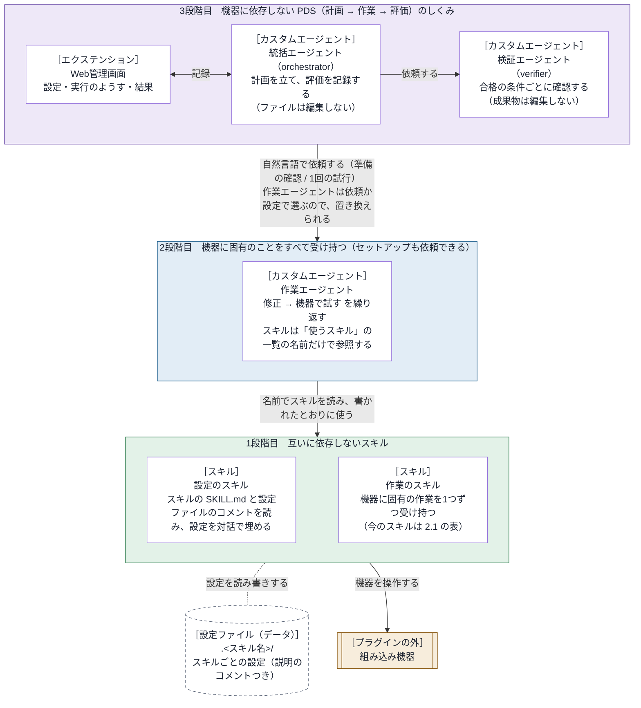

# embedded-debug-loop 設計書

内部のしくみと、部品の間の取り決め（インターフェース）を書く。
利用者から見た振る舞いは [仕様書](../specs/requirements.md) にある。

- バージョン：0.4.0

## 1. 基本の考え方

> **組み込み機器に固有のことは、すべて作業エージェントが受け持つ。**

部品は、3つの段階（部品の階層）に分かれる（2章の図）。
上の段階は、下の段階の部品を名前だけで参照する（中身に依存しない）。
そのため、作業エージェントを置き換えれば別の機器でも動き、スキルを置き換えても上の段階は変わらない。
どの段階も、上の段階なしで使える（使い方は 2.1 の表）。
文書も同じ考え方で分ける。各部品の使い方は、その部品の使い方の文書にだけ書く（3.7）。

## 2. アーキテクチャ

### 2.1 ブロックごとの置き場所と知識

| ブロック | 置き場所 | 使う Copilot CLI の機能 | 持っている知識 |
| --- | --- | --- | --- |
| Web管理画面 | `extensions/embedded-debug-loop/` | 4章を参照 | 統括エージェント向けのツール、画面、Copilot CLI のイベント。既定の作業エージェントの名前は `defaults.json` にだけ置く |
| 統括エージェント | `agents/orchestrator.agent.md` | `/agent` で選ぶ。`tools`：`agent`（`task` で作業エージェントと検証エージェントを呼ぶ）・`read`・`search`・`ask_user`・エクステンションのツール | PDS の進め方。作業エージェントの名前は設定から受け取る |
| 検証エージェント | `agents/verifier.agent.md` | 統括エージェントが `task` で呼ぶ。`tools`：`read`・`search` | 合格の条件ごとに確認する方法 |
| 作業エージェント | `agents/<作業エージェントの名前>.agent.md` | `/agent` で選ぶか、`task` で呼ばれる。`tools`：`read`・`edit`・`search`・`execute`・`skill`・`ask_user` | 使うスキルの名前（「使うスキル」の一覧） |
| スキル | `skills/<スキル名>/` | `/embedded-debug-loop:<スキル名>`（フォルダだけをコピーしたときは `/<スキル名>`）か `skill` ツール。スクリプトはシェルのツールで実行する。設定のスキルは `skill` ツールで設定するスキルを読み、`ask_user` で質問する | 自分のことだけ。設定のスキルは、Copilot CLI が読み込んだスキルの SKILL.md と設定ファイルのコメントから、設定の内容を読み取る（3.3） |

- `agents/` と `extensions/` は、`com.github.copilot/` の下にある。
- スキルのフォルダには、`SKILL.md`、`scripts/` の Python のスクリプト、`tests/` がある。README.md は置かない（Anthropic のスキル作成ガイド）。人向けの使い方は `docs/guide/1-<スキル名>.md` にある。設定を持つスキルは、設定のひな形も持つ。
- `SKILL.md` は、エージェントが読む概要にとどめる（何をするか、コマンド、結果の読み方）。まれにしか要らない詳細は `reference/` のファイルに分け、`SKILL.md` から1段でたどれるようにする。
- 設計書には、スキルと作業エージェントの名前と中身を書かない。各スキルの中身は、そのスキルの SKILL.md と使い方の文書にある。
- `agents/` には、エージェントの定義のほかのファイルを置かない。Copilot CLI は `agents/` の中の `.md` をエージェントの定義として読む（`.agent.md` でなくても読む。2026年11月の公式文書）。作業エージェントの使い方は `docs/guide/2-<作業エージェントの名前>.md` に書く（3.7）。
- 使っていない部品：MCP サーバー、プラグインのフックの設定（`hooks.json`。フックはエクステンションで登録する）、LSP、指示ファイル。
- エクステンションは、Copilot CLI の試験的な機能である（2026年11月の公式文書。`/experimental on` か `--experimental` で有効にする）。1.0.105 では既定で読み込まれることを確かめた。SDK の API とイベントの形は版で変わりうるので、新しい版では 3段階目を一通り動かして確かめる。
- スキルのスクリプトは、Python 3.8 以上の標準ライブラリだけで書く。ほかのものが要るスキルは、`scripts/vendor/` に同梱し、自分のフォルダの `vendor` を `sys.path` の先頭に足して使う。マニフェストは `plugin.json`（Agent Plugins の形式）。

## 3. 部品の間の取り決め

### 3.1 作業エージェントとスキル

作業エージェントは、スキルを `skill` ツールで読み、`SKILL.md` のとおりに使う。
スクリプトの名前も `SKILL.md` から知る（作業エージェントの定義には書かない）。
作業エージェントがスキルに頼むのは、作業と設定の確認だけである。セットアップは、設定を受け持つスキルに任せる（3.3）。

作業エージェントの定義は、使うスキルの名前を「使うスキル」の一覧にだけ書く。

- スキルが何をするか、いつ使うかは、定義に書かない。Copilot CLI は、スキルの description を見て、使うスキルを決める（2026年11月の公式文書）。
- そのため、スキルを足す・消す・置き換えるとき、作業エージェントで直すのは一覧だけである。

スキルのスクリプトとコマンドは、そのスキルの SKILL.md と使い方の文書に書く。作業エージェントと設計書には書かない。

### 3.2 設定ファイル

- 置き場所：作業フォルダ（ふつうは、Copilot CLI を起動したフォルダ）の `.<スキル名>/`。ログは `.<スキル名>/logs/`。フォルダには `.gitignore`（中身は `*`）を作る。
- スキル名は、スキルのフォルダの名前（別の名前でコピーすれば、その名前）。プラグインの名前は使わない（3.4）。
- 形式と項目は、スキルが決める。場所と作り方は SKILL.md に、各項目の説明は項目のすぐ上のコメントに書く（設定のスキルが読む）。
- 設定のスキルは、コメントの次の言葉で項目を見分ける。新しいスキルの設定ファイルも、これに合わせる。
  - 「必須」：必ず埋める項目。「必ず」：必須ではないが、ふつうは埋める項目。
  - 「例：」の後の値：書ける値の例。「選べる値：a / b / c」：この中からしか選べない。
  - 項目名に password・passphrase・secret・token・api_key・パスワード・暗証などを含む項目は、秘密の値として扱い、画面に出さない。
  - `<項目>_env` の項目には、その値を渡す環境変数の名前を書く。

### 3.3 設定のスキルとほかのスキル

設定のスキルは、設定ファイルを持たず、特定のスキルの名前・項目・置き場所を知らない。
設定するスキルの SKILL.md と設定ファイルのコメントだけを頼りに、利用者に聞きながら設定を埋める。

設定のスキルは、スキルを探す場所と順を持たない。設定するスキルは、Copilot CLI が選んだものを使う。

- 名前を渡されなければ、設定のスキルが使えるスキルの一覧（Copilot CLI が示す名前と説明）から、自分を除いて、利用者に `ask_user` で選んでもらう。
- 設定するスキルは、その名前を `skill` ツールに渡して読む。Copilot CLI は、SKILL.md の本文とともに、スキルのフォルダ（Base directory for this skill）と、フォルダの中のファイルの絶対パス（Related files）を示す（1.0.102 で実測）。設定のスキルは、SKILL.md から設定ファイルの場所と作り方を知り、設定ファイルのコメントから項目の意味を読む。読んだスキルの手順は実行しない。
- そのため、同じ名前のスキルがいくつかあっても、Copilot CLI が使うスキルを設定する。Copilot CLI がスキルを選ぶ決まりを変えても、設定のスキルは直さずに済む。プラグインに入れたときも、フォルダだけをコピーしたときも、同じ手順で動く。

聞く順は、設定のスキルの SKILL.md にある。

### 3.4 スキルのフォルダ

スキルのフォルダは、それだけで完結させる。プラグインをインストールせず、フォルダだけをコピーして使う人がいるためである。
フォルダの中のファイル（コメントとエラーメッセージを含む）には、次を書かない：プラグインの名前とその略、ほかのスキル・エージェント・Web管理画面・エクステンション、フォルダの外を指すパス。

### 3.5 統括エージェントと作業エージェント

2つのエージェントは、自然言語の依頼だけでやり取りする。依頼は2種類ある。

| 依頼 | 作業エージェントの応答 |
| --- | --- |
| 準備の確認（作業はしない） | 1行目が「準備：できている」か「準備：できていない」。続けて、設定の要約と足りないもの。合格の条件を確かめられないときは、それも足りないものに書く |
| 試行（1回だけ。合否は判断しない） | 変えたこと、手順ごとの結果（「できた」か「できなかった（理由）」）、判断に要るログの行、ログの場所 |

返事の形は、統括エージェントの依頼の文（ひな形）だけで決める。作業エージェントの定義には、統括エージェントとの決まりを書かない。作業エージェントは、依頼の文が求める形で返す。

作業エージェントは、依頼の文に書かれた手順と返事の形に従う。質問と合否の判断をしないことも、依頼の文に書く。Copilot CLI は、`task` で呼ばれたサブエージェントに `ask_user` を渡さない（1.0.98 と 1.0.102 で確認）。

準備の確認は、`open`（3.6）が返した作業エージェントに頼む。
`open` が返すのは、この会話で依頼に書かれた名前か、Web管理画面で選んだ名前、どちらもなければ `defaults.json` の名前である。
エージェントの名前は、入ってくる所（`open` と `prepare` の `worker`、Web管理画面の保存と「開始」）で、Copilot CLI のエージェントの一覧の id にそろえる。id が同じものがなく、名前か表示名が同じものも1つに決まらなければ、使えるエージェント（id と /agent での見え方）を示して断る。ほかの所では、id をそのまま比べる。
作業フォルダごとにファイルに保存するのは、繰り返しの上限だけである。使うエージェントの名前と、エージェントごとのモデル・考える深さは保存せず、その会話のあいだだけ使う。部品によって変わるものを保存すると、部品を替えたとき前の値が残るためである。
Web管理画面で替えたときは、替えた作業エージェントの準備の確認がまだないので、「開始」の知らせで確認させる。

### 3.6 統括エージェントとエクステンション

| 統括エージェントが使うツール（名前の頭は `embedded-debug-loop_`） | 呼ぶとき | すること |
| --- | --- | --- |
| `open` | 依頼を受けたとき | 画面のサーバーを起動し、依頼と合格の条件を「開始」前の下書きに入れ、今の設定を返す。作業エージェントの名前を渡されたら、一覧の id にそろえ（3.5）、この会話のあいだ使う |
| `prepare` | 準備の確認の応答を受けたとき | 応答を Web管理画面の「設定」に出す。できていなければ、確かめた作業エージェントの id と /agent での見え方を添えて、利用者に伝えさせる |
| `plan` | 試行の始め | 計画を記録する |
| `study` | 評価の後 | 条件ごとの合否と、次にすることを記録する |
| `finish` | 終わるとき | 結論と振り返りを記録する |
| `issue` | 利用者が Issue の作成に同意したとき | `gh` で Issue を作成する |

「開始」の後、エクステンションは次のことをする。

- `session.send` で開始のメッセージをチャットに送る。統括エージェントは、これを受けて試行を始める。
- 作業エージェントと検証エージェントのモデルと考える深さを、`tools.updateSubagentSettings` で設定する（定義ファイルは書き換えない）。これはセッションの中だけの上書きで、Copilot CLI の利用者の設定には残らない。開始のたびに上書きを消し、利用者の設定に、今の2つのエージェントの分だけを足して書き直す（前の実行で書いた分は残さない）。
- 2つのエージェントの応答を、フック `onSubagentStop` で受け取り、試行の記録に入れる。
- フック `onPreToolUse` で、統括エージェントのファイル編集（edit など）・コマンド（bash など）・スキル（skill）のツールを拒否する。統括エージェントの `task` も、作業エージェントと検証エージェントのほかへの依頼を拒否する。
  親のセッションで動くエージェントは、すべて統括エージェントとみなす。実行中にチャットでほかのエージェントに替えても、同じく拒否する（ガイドに書く）。
- 作業の報告がある試行で、新しい計画なしに作業エージェントを呼ぶことも拒否する（報告と評価が食い違うため）。

記録のツールは、モデルの判断をそのまま受けず、次のことを確かめる。

- `study`：すべての合格の条件（C1〜Cn）の評価がそろっていること。合格（pass）は、その試行で検証エージェントを呼んだときだけ受け付ける。
- `finish`：outcome が success なら、最後の試行の評価がすべて合格であること。
- `prepare`：準備ができているかは、返事の1行目（「準備：できている」か「準備：できていない」）で決める。1行目にその形がないときだけ、統括エージェントが渡した値を使う。
- `issue`：このツールだけは Copilot CLI の許可の確認を通す（ほかの記録のツールは確認を省く）。作った Issue は、終わった実行の `events.jsonl` に残す。

「止める」が押されたら、`session.abort()` で今の応答を止める。その後は、`embedded-debug-loop_finish` 以外のツールをすべて拒否する。
統括エージェントが終わりを記録せずに止まったら、エクステンションが結論を書く。結論には、止めた試行の番号と工程（計画・作業・評価）を書く。
どの終わり方でも、結論に、編集のツール（edit・create・apply_patch）で変えたファイルの一覧を足す。変えたファイルは元に戻さない。

試行の記録に入れなかった作業・検証エージェントの応答（止めた後や、計画の記録の前に届いたものなど）は、理由を付けて `events.jsonl`（4章）にだけ残す。

#### 統括エージェントの tools の制限

統括エージェントにファイル編集・コマンド・スキルを使わせないため、3つの対策を重ねる。
定義の `tools` を絞るだけでは足りない。`tools` に `skill` がなくても、Copilot CLI は `skill` のツールとスキルの一覧を渡すためである。

1. 定義の `tools` を、エージェントの呼び出し・読み取り・検索・質問・記録のツールに絞る。
2. 定義で、自分では作業しない（ファイルを編集しない、コマンドを実行しない）と指示する。作業の方法と、作業エージェントの応答に出た道具・スキル・設定ファイル・手順の名前も、計画や依頼に書かせない。
3. 「開始」の後は、エクステンションがこれらのツールを拒否する。

なお、Copilot CLI 1.0.105 では、統括エージェントの `tools` を絞っても、それが呼ぶ作業エージェントは自分の `tools` を使えた（テストで確認）。

### 3.7 文書の置き場所

各部品の使い方は、その部品の使い方の文書にだけ書く。下の段の部品を置き換えても、上の段の文書を直さずに済むようにするためである。

| 部品 | 文書 | 書くこと |
| --- | --- | --- |
| スキル | `docs/guide/1-<スキルの名前>.md` | 何をするか、必要なもの、置き方、呼び方、設定（場所・作り方・項目の意味）、うまくいかないとき、テスト。スキルのフォルダには置かない（Anthropic のスキル作成ガイド） |
| 作業エージェント | `docs/guide/2-<作業エージェントの名前>.md` | その作業エージェントのことだけ（何をするか、選び方、頼み方、注意、うまくいかないとき）。定義と組で置き換える。使うスキルは、定義の一覧を案内する（スキルの名前を書かない） |
| 3段階目 | `docs/guide/3-orchestrator.md` | 統括エージェント・検証エージェント・Web管理画面の使い方 |
| プラグイン全体 | `README.md` | 何をするプラグインか、3つの段階と見る文書、必要なもの、インストール、開発者向けの文書への案内 |
| 部品を変える | `docs/replace.md` | 開発者向け。スキルを足す・消す・置き換える手順と、作業エージェントを置き換える手順。直すファイルと行を、今の部品の名前を例にして書く |

- 上の段の文書（`README.md`、`3-orchestrator.md`）には、スキルの名前と、転送・ログ取得の具体（FTP、シリアル、COM ポートなど）を、例としても書かない。
- 作業エージェントの使い方の文書は、スキルの名前を書かない。転送・ログ取得の具体と、設定の項目も書かない。
- どちらも、独立性のテスト（5章）で確かめる。

### 3.8 Windows への対応

利用者の PC は Windows である。Copilot CLI は、Windows ではコマンドを PowerShell（6 以上）で実行する。Linux でも同じスキルが動く。

| 項目 | 決まり |
| --- | --- |
| SKILL.md のコマンド | bash だけの書き方（ヒアドキュメント、`source`、`$(...)` など）に頼らない。Python は `<python>` と書き、Windows では `py -3`（なければ `python`）、ほかでは `python3` と決める |
| 標準出力 | Windows で出力先がパイプのときは、コンソールの文字コード（`GetConsoleOutputCP`）で書く。PowerShell はこの文字コードで読む（Python 3.15 からの既定の UTF-8 モードのままだと、日本語の Windows では文字化けする）。それ以外は Python の既定の文字コード。JSON は、書けない文字を JSON の `\uXXXX` にしてから書く。経過（標準エラー）は `errors="backslashreplace"` で書く |
| ファイル | 設定ファイルとログは、いつも UTF-8 で読み書きする |
| パス | `os.path`・`pathlib` で扱い、区切りの `/` を決め打ちしない（機器の中のパスは別。機器は Linux） |

スキルのテストは、GitHub Actions の Windows のマシンでも動かす（5章）。Copilot CLI と組み合わせた Windows での動作は、まだ確認していない。

## 4. エクステンションの中

追加のパッケージは使わない。

| ファイル | 役目 |
| --- | --- |
| `extension.mjs` | 入口。Copilot SDK の `joinSession` を `adapter.mjs` に渡す。SIGTERM・SIGINT では、記録を書き終え、サーバーを閉じて終わる |
| `adapter.mjs` | Copilot CLI との接続部分。ツール・フック・イベント（`session.on`）を登録する。`session` の `send`・`abort`・`log`（チャットへの通知）・`rpc`（エージェントとモデルの一覧、エージェントの切り替え、サブエージェントの設定）を `core/control.mjs` に渡す |
| `defaults.json` | 既定の値（3つのエージェントの名前、繰り返しの上限、Issue の作成先）。コードには書かない |
| `core/messages.mjs` | モデルと利用者に見せる文 |
| `core/store.mjs` | 状態（設定・下書き・今の実行・過去の実行の一覧）と、画面に渡すスナップショット |
| `core/persist.mjs` | 記録のファイルの読み書き |
| `core/tools.mjs` | 6つのツール（3.6） |
| `core/events.mjs` | イベントから、試行の記録、動いているエージェント、入力待ち（質問・許可）の通知、画面の「くわしい記録」の行を作る |
| `core/guard.mjs` | `onPreToolUse` で拒否するかを決める（3.6） |
| `core/control.mjs` | 画面からの操作（下の API） |
| `ui/server.mjs` | 画面のサーバー。127.0.0.1 だけで待ち受け、トークン（URL の `k` か、初回に渡すクッキー）が合わない要求を拒否する。POST は、Origin が同じ画面からの、`Content-Type: application/json` のものだけを受ける（クッキーはポートを区別しないので、同じ PC のほかのポートの画面からの送信を断る） |
| `ui/static/` | 画面（`index.html`・`app.js`・`style.css`）。状態を 1.5 秒ごと（隠れているときは 5 秒ごと）に読む。開いたら、アドレスバーからトークンを消す |

画面のサーバーの API：

| API | すること |
| --- | --- |
| `GET /api/state` | スナップショット（選べるエージェントとモデルを含む）を返す |
| `POST /api/settings` | 設定を保存する |
| `POST /api/start` | 開始する |
| `POST /api/stop` | 止める |
| `GET /api/runs/<実行の番号>` | 過去の実行の記録を返す |

記録の置き場所は `<COPILOT_HOME または ~/.copilot>/plugin-data/embedded-debug-loop/`。

- `settings.json`：作業フォルダごとの繰り返しの上限。`folders` のキーが作業フォルダのパス、値が `{ "maxIterations": … }`。ほかの項目は読まない。Windows では、パスの大文字と小文字を区別しない。
  - この作業フォルダは、セッションの作業フォルダ（`/cd` で変わる）。取得できなければ、エクステンションのプロセスの今のフォルダ（`process.cwd()`）。
  - 保存がなければ、`defaults.json` の値を使う。
- `runs/<実行の番号>/run.json`：実行の記録。書いた Copilot CLI のプロセスの番号（`pid`）と、変えたファイル（`changedFiles`）も入れる。
  - 起動したとき、「実行中」か「止めている途中」のまま残り、`pid` のプロセスがもう動いていない実行を、「途中で止めた」として閉じる（Copilot CLI が途中で終わったため）。ほかの Copilot CLI が動かしている実行は閉じない。
- 記録のフォルダとファイルは、本人だけが読める権限（0700・0600）で作る。
- `runs/<実行の番号>/events.jsonl`：イベントのログ（1行に1件の JSON。拒否したツールなども残す）。振り返りに使う。

## 5. テスト

プラグインのフォルダで `python3 tests/run.py`（Windows では `py -3 tests/run.py`）を実行すると、すべてのテストが動く。
すべて合格なら終了コード 0、不合格か動かせないテストがあれば 1。

| テスト | 置き場所 | 確認すること |
| --- | --- | --- |
| スキル | `skills/<スキル名>/tests/` | スクリプトの振る舞い。フォルダだけをコピーしても、`python -m unittest discover -s tests` で動く |
| 独立性 | `tests/independence/` | 段階をまたぐ依存がない。スキルのフォルダが 3.4 の決まりを守る。スキルのフォルダ1つだけをコピーしても、そのスキルのテストが通る（データの置き場所などは、各スキルのテストで確かめる）。上の段の文書に下の段の中身がない（3.7）。スキルの一覧は `skills/` の下のフォルダから、作業エージェントは `defaults.json` から、使うスキルは作業エージェントの定義の「使うスキル」の一覧から読む（テストに部品の名前を書かない） |
| エクステンション | `tests/extension/` | 模擬のセッションで、ツール・開始・イベント・停止・API・`onPreToolUse` の拒否。模擬の DOM で、画面（`app.js`）。3段階目の独立性（作業の中身を参照せず、`defaults.json` の作業エージェントの名前を置き換えても動く） |
| EVAL | `tests/eval/` | 実際のモデルで、答えの決まった不具合の課題を解かせ、合否の基準（`eval.json`）で採点する。模擬の機器（`tests/eval/device_sim.py`：FTP と bash のコンソール）を起動して流す。AI クレジットを使うので、CI では動かさない。エージェントの定義・スキル・モデルを変えたときに流す |
| 文書 | `tests/docs/` | 版の一致（`plugin.json`・仕様書・設計書・変更履歴・マーケットプレイスの一覧）。設計書とテストが挙げる要求の番号が仕様書にあり、仕様書の要求がどれも 6章の表にある |

GitHub Actions（リポジトリの根の `.github/workflows/embedded-debug-loop.yml`）でも、次のテストを自動で動かす。

| ジョブ | マシン | 動かすもの |
| --- | --- | --- |
| スキル | `windows-latest`・`ubuntu-24.04` × Python 3.8・3.12・最新の安定版（`3.x`） | `skills/` の下の、`tests/` があるすべてのスキルのテスト（スキルのフォルダで `python -m unittest discover -s tests`） |
| 独立性 | `windows-latest`・`ubuntu-24.04` × Python 3.12 | `tests/independence/`、`tests/docs/` |
| Web管理画面 | `windows-latest`・`ubuntu-24.04` × Node 22・24 | `tests/extension/` |

- スキルと独立性のジョブでは、各スキルの `tests/requirements.txt` にあるパッケージを入れる。CI の定義に、スキルの名前とパッケージの名前を書かない。
- 設定のスキルを PowerShell から使うテスト（標準入力と文字コード）は、そのスキルの `tests/` に置き、Windows のスキルのジョブで動く。
- Linux は `ubuntu-24.04` に固定する。`ubuntu-latest` は 2026年10月から Ubuntu 26 に移り、Python 3.8 を入れられないおそれがある。

## 6. 要求の追跡

仕様書の要求を、設計書の節と、確かめ方（自動のテスト、または手動の確認）に対応づける（憲章 第6条3項）。
スキルのテストは、各スキルの `tests/` にある。

| 要求 | 設計書 | 確かめ方 |
| --- | --- | --- |
| REQ-001 | 1、2.1 | `tests/independence/` |
| REQ-002 | 1、2.1 | `tests/independence/` |
| REQ-003 | 3.1 | `tests/independence/` |
| REQ-004 | 2.1、3.4 | `tests/independence/` |
| REQ-005 | 3.5、3.6 | `tests/extension/tools.test.mjs`・`server.test.mjs` |
| REQ-006 | 3.8、5 | 各スキルの `tests/`（CI の Windows）。Copilot CLI と組み合わせた Windows での動作は手動の確認（未確認） |
| REQ-007 | 3.7 | `tests/independence/` |
| REQ-101 | 3.1 | 各スキルの `tests/` |
| REQ-102 | 3.2 | 各スキルの `tests/`、`tests/independence/` |
| REQ-103 | 3.2 | 各スキルの `tests/` |
| REQ-104 | 3.2 | 各スキルの `tests/` |
| REQ-105 | 3.1 | 各スキルの `tests/` |
| REQ-106 | 3.2 | 各スキルの `tests/` |
| REQ-107 | 3.1 | 各スキルの `tests/` |
| REQ-108 | 3.4、3.7 | 各スキルの `tests/`、`tests/independence/` |
| REQ-109 | 2.1、3.8 | 各スキルの `tests/`（CI の Windows・Python 3.8） |
| REQ-110 | 2.1、3.7 | `tests/independence/` |
| REQ-111 | 3.3 | 各スキルの `tests/` |
| REQ-201 | 2.1 | `tests/independence/` |
| REQ-202〜REQ-206 | 3.1 | 作業エージェントの定義。振る舞いは EVAL（`tests/eval/`） |
| REQ-207 | 3.5 | `tests/independence/`（返事の形は統括エージェントの頼みの文で決める） |
| REQ-208 | 2.1 | 作業エージェントの定義。振る舞いは EVAL（`tests/eval/`） |
| REQ-301〜REQ-303 | 3.5、3.6 | `tests/extension/tools.test.mjs` |
| REQ-304・REQ-305 | 3.6 | `tests/extension/tools.test.mjs`・`events.test.mjs` |
| REQ-306・REQ-309 | 3.6 | `tests/extension/guard.test.mjs` |
| REQ-307 | 2.1 | 検証エージェントの定義。振る舞いは EVAL（`tests/eval/`、3段階目で流す） |
| REQ-308 | 3.6 | `tests/extension/tools.test.mjs` |
| REQ-311 | 4 | `tests/extension/server.test.mjs` |
| REQ-312〜REQ-314 | 3.5、4 | `tests/extension/server.test.mjs`・`ui.test.mjs` |
| REQ-315・REQ-316 | 4 | `tests/extension/ui.test.mjs`・`events.test.mjs` |
| REQ-317 | 3.6 | `tests/extension/stop.test.mjs`・`guard.test.mjs` |
| REQ-318 | 4 | 手動の確認（幅 390 px、ライトとダーク） |
| REQ-321 | 4 | `tests/extension/stop.test.mjs`・`tools.test.mjs` |
