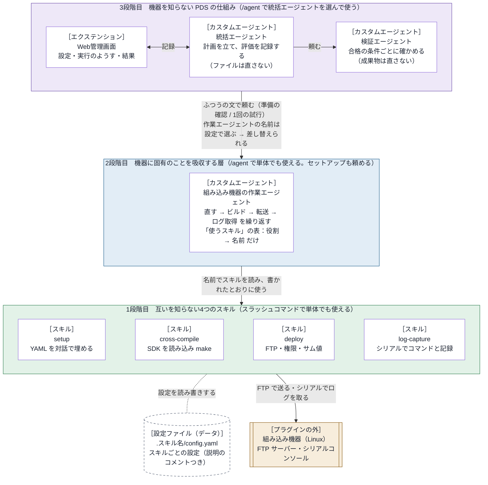

# embedded-debug-loop 設計書

- 版：0.3.0
- この文書は、embedded-debug-loop の中のしくみを書く。利用者から見た振る舞いは [仕様書](../specs/requirements.md) にある。

## 1. 本質的なコンセプト

> **組み込み機器に固有のことは、すべて2段階目の作業エージェントが吸収する。**

| 段階 | 役目 |
| --- | --- |
| 3段階目 | 統括・検証・Web管理画面。機器を一切知らない、どの機器にも使える PDS の仕組み。作業エージェントには、ふつうの文で頼むだけ。作業エージェントを差し替えれば、別の機器でも動く。 |
| 2段階目 | 組み込み機器の作業エージェント。機器に固有の作業（直す → ビルド → 転送 → ログ取得）を受け持つ層。使うスキルの「名前と役割」だけを知り、中身は知らない。 |
| 1段階目 | 4つの独立したスキル（セットアップ・クロスコンパイル・デプロイ・ログキャプチャー）。互いを一切知らず、どれも単体で使える。差し替えても、上の段は変わらない。 |

どの段も、それより上の段なしで使えます。1段階目はスラッシュコマンド、2段階目と3段階目は `/agent` で選んで使います。

## 2. アーキテクチャ

矢印は「頼む・使う」の向きです。上の段は、下の段の名前（作業エージェントの名前・スキルの名前）だけを持ち、中身は持ちません。
図の［ ］は、そのブロックを作っているハーネスの部品の種類です。

### 2.1 ブロックごとのハーネスの部品

| ブロック（図） | ハーネスの部品 | 置き場所 | 使っている Copilot CLI の機能 | 知っていること |
| --- | --- | --- | --- | --- |
| Web管理画面 | エクステンション | `com.github.copilot/extensions/embedded-debug-loop/`（入口は `extension.mjs`。既定の値は `defaults.json`） | 統括エージェント向けのツール6つ（`embedded-debug-loop_open`・`_prepare`・`_plan`・`_study`・`_finish`・`_issue`）。フック2つ（`onPreToolUse`：実行中の統括エージェントのファイル編集・コマンド・スキルを断る。`onSubagentStop`：作業・検証エージェントの返事を受け取る）。イベントの受け取り（`session.on`）。`session.send`（開始の知らせ）・`session.abort`（止める）・`session.log`（チャットへの知らせ）。`session.rpc`（エージェントの一覧と切り替え、モデルの一覧、サブエージェントのモデルと考える深さの設定）。127.0.0.1 の HTTP サーバー（画面） | 記録のツール、画面、Copilot CLI のイベント。既定の作業エージェントの名前は `defaults.json`（データ）にだけある |
| 統括エージェント | カスタムエージェント | `com.github.copilot/agents/orchestrator.agent.md` | `/agent` で選ぶメインのエージェント。`tools`：`agent`（`task` で作業エージェントと検証エージェントを呼ぶ）・`read`・`search`・`ask_user`・エクステンションのツール6つ | PDS の進め方。作業エージェントの名前は設定から受け取る |
| 検証エージェント | カスタムエージェント | `com.github.copilot/agents/verifier.agent.md` | 統括エージェントから `task` で呼ばれるサブエージェント。`tools`：`read`・`search` | 合格の条件で確かめること |
| 組み込み機器の作業エージェント | カスタムエージェント | `com.github.copilot/agents/device-worker.agent.md` | `/agent` で選ぶメインのエージェント、または統括エージェントから `task` で呼ばれるサブエージェント。`tools`：`read`・`edit`・`search`・`execute`・`skill`（スキルを読む）・`ask_user` | スキルの名前と役割（「使うスキル」の表） |
| setup | スキル（`SKILL.md` ＋ Python のスクリプト ＋ 使い方の `README.md` ＋ 試験） | `skills/setup/`（`scripts/config_tool.py`、`tests/`） | スラッシュコマンド `/embedded-debug-loop:setup`（フォルダだけを写したときは `/setup`）、または `skill` ツール。質問は `ask_user` | 自分のことだけ（YAML のコメントだけを頼りにする） |
| cross-compile | スキル（`SKILL.md` ＋ Python のスクリプト ＋ 設定のひな形 ＋ 使い方の `README.md` ＋ 試験） | `skills/cross-compile/`（`scripts/build.py`、`config-template.yaml`、`tests/`） | スラッシュコマンド `/embedded-debug-loop:cross-compile`（フォルダだけを写したときは `/cross-compile`）、または `skill` ツール。スクリプトはシェルのツールで動かす | 自分のことだけ |
| deploy | スキル（同上） | `skills/deploy/`（`scripts/deploy.py`、`config-template.yaml`、`tests/`） | スラッシュコマンド `/embedded-debug-loop:deploy`（フォルダだけを写したときは `/deploy`）、または `skill` ツール | 自分のことだけ |
| log-capture | スキル（同上） | `skills/log-capture/`（`scripts/capture.py`、`config-template.yaml`、`tests/`） | スラッシュコマンド `/embedded-debug-loop:log-capture`（フォルダだけを写したときは `/log-capture`）、または `skill` ツール | 自分のことだけ |
| 設定ファイル | ハーネスの部品ではない（利用者のデータ） | 作業フォルダの `.<スキル名>/config.yaml`（ログは `.<スキル名>/logs/`） | — | — |
| 組み込み機器 | プラグインの外 | — | — | — |

- 使っていない部品：MCP サーバー（`mcp.json`）、プラグインのフックの設定（`hooks.json`）、LSP、指示ファイル（`copilot-instructions.md` など）。
- フックは、プラグインの `hooks.json` ではなく、エクステンションの中で登録している（上の表の `onPreToolUse`・`onSubagentStop`）。
- スキルのスクリプトは、Python 3 の標準ライブラリだけで書いている（追加のパッケージは要らない）。
- プラグインの全体の情報は `plugin.json`（Agent Plugins の形式）にある。

## 3. 部品の間の約束

### 3.1 作業エージェントとスキル

作業エージェントは、スキルを `skill` ツールで読み、SKILL.md に書かれたとおりに使う。
ビルド・転送・ログ取得のスキルは、次の3つの頼みに応える。

| 頼み | スクリプトの呼び方 | 返すもの（JSON） |
| --- | --- | --- |
| 作業 | `<スクリプト> run` | `ok`、`message`、`log`、スキルごとの結果 |
| 設定ファイルの場所 | `<スクリプト> config-path` | `config`、`created`、`missing` |
| 設定の確認 | `<スクリプト> check` | `ok`、`problems`、`summary` |

- スクリプトは、標準出力に JSON を1つだけ出す。経過は標準エラーに出す。
- 終了コード：0 はできた。1 は作業（ビルド・転送・ログ取得）が失敗した。2 は設定に問題がある。`check` では、機器につながらないときも 2。`config-path` は、ふつう 0。
- 作業エージェントは、スクリプトの名前を知らない。スキルを読んだときに分かる。

### 3.2 設定ファイル

- 置き場所：`<作業フォルダ>/.<スキルの名前>/config.yaml`。ログは `.<スキルの名前>/logs/` に置く。フォルダには `.gitignore`（中身は `*`）を作る。
  - スキルの名前は、スクリプトの場所から求めた、スキルのフォルダの名前。名前を変えて写せば、その名前になる。プラグインの名前は使わない（スキルのフォルダだけを写して使う人は、プラグインを入れていないため）。
  - 作業フォルダは、スクリプトを動かしたときの今のフォルダ。ふつうは、Copilot CLI を起動したプロジェクトのフォルダ。`--workdir` で作業フォルダを、`--config` で設定ファイルを変えられる。
  - 結果の JSON の `skill` と、ログのファイルの名前の頭も、スキルのフォルダの名前にする。経過の表示に頭（`[名前]`）を付けるスキルは、その頭もスキルのフォルダの名前にする。
- 形：1段だけの `項目: 値`。値は、文字、数、true/false、null、文字の並び。各項目のすぐ上に `#` で説明を書く。
- ビルド・転送・ログ取得のスキルは、自分のフォルダに `config-template.yaml`（ひな形）を持つ。設定ファイルがなければ、ひな形を写して作る。設定のスキル（setup）は、ひな形も設定ファイルも持たない。
- YAML を読むコードは、スキルごとに持つ（共有しない）。追加のパッケージは使わない。
- 設定のスキル（setup）は、この形のファイルなら、どれでも埋められる。ほかのスキルのことは知らない。ファイルを渡されなければ、作業フォルダの中（深さ3まで。`.git`・`node_modules` などと、`SKILL.md` があるフォルダ（スキルのフォルダ）は飛ばし、点で始まるフォルダは見る）から、項目のすぐ上に `#` の説明がある YAML を探して候補にする。

### 3.2.1 スキルのフォルダ

- スキルのフォルダは、それだけで完結させる。利用者は、プラグインを入れずに、フォルダだけを写して使うことがあるため。
- フォルダの中（`SKILL.md`、`README.md`、スクリプト、ひな形、コメント、試験、エラーのメッセージ）に、プラグインの名前とその略・ほかのスキル・エージェント・Web管理画面・エクステンションのことを書かない。フォルダの外のパスを指さない。
- 人向けの使い方は、フォルダの `README.md` に書く。試験は、フォルダの `tests/` に置き、スキルのフォルダで `python3 -m unittest discover -s tests` で動かす。

### 3.3 統括エージェントと作業エージェント

ふつうの文の頼みだけでやり取りする。頼みは2種類ある。

| 頼み | 作業エージェントの返事 |
| --- | --- |
| 準備の確認（作業はしない） | 1行目が「準備：できている」か「準備：できていない」。続けて設定の要約と足りないもの |
| 試行（1回。合否は判断しない） | 試行の番号、変えたこと、ビルド・転送・ログ取得の結果、ログの要点、ログの場所 |

作業エージェントは、次のどちらかに当たれば、ほかのエージェントから頼まれていると見分ける。

- 質問のツール（ask_user）が使えない。ほかのエージェントから `task` で呼ばれたエージェント（サブエージェント）には、ask_user が渡らないためである（Copilot CLI 1.0.98 と 1.0.102 で確かめた）。
- 頼みの文が「これは準備の確認です」か「あなたは作業役です」で始まる（統括エージェントのひな形の書き出し）。

### 3.4 統括エージェントとエクステンション

| ツール | 呼ぶとき | すること |
| --- | --- | --- |
| `embedded-debug-loop_open` | 頼みを受けたとき | 画面のサーバーを起動し、頼みと合格の条件を下書きにする。今の設定（作業エージェントの名前など）を返す |
| `embedded-debug-loop_prepare` | 準備の確認の返事を受けたとき | 返事を設定の画面に出す |
| `embedded-debug-loop_plan` | 試行の始め | 計画を記録する |
| `embedded-debug-loop_study` | 評価の後 | 条件ごとの合否と次の手を記録する |
| `embedded-debug-loop_finish` | 終わるとき | 結論と振り返りを記録する |
| `embedded-debug-loop_issue` | 利用者が Issue に同意したとき | `gh` で起票する |

- 「開始」が押されると、エクステンションが `session.send` で、開始の知らせをチャットに送る。統括エージェントは、それを受けて試行を始める。
- 作業エージェントと検証エージェントの返事は、エクステンションがフック `onSubagentStop` で受け取り、試行の記録に入れる。統括エージェントが書き写す必要はない。
- 「開始」の後は、エクステンションがフック `onPreToolUse` で、統括エージェント（メインのエージェント）が、ファイルを直すツール（edit など）・コマンドのツール（bash など）・スキルのツール（skill）を使うのを断る。「開始」の前は断らない。
- 「開始」の後、今の試行に作業の報告がもうあるのに、新しい計画を記録せずに作業エージェントを呼ぼうとしたときも断る（同じ試行の番号で作業を頼み直すと、報告と評価が食い違うため）。
- 試行の記録に入らなかった作業エージェントと検証エージェントの返事も、`events.jsonl` に、入らなかった理由をつけて残す。
- 「止める」が押されると、`session.abort()` でいまの応答を止め、その後のツールの使用を断る（`embedded-debug-loop_finish` だけは通す）。
  - 統括エージェントが終わりを記録しないまま止まったときは、エクステンションが結論を書く。押したときの記録から、どこで止めたかを書く。ファイルを直すツール（edit・create・apply_patch）で変えたファイルも、元に戻していないものとして書く。
  - 止めた後に届いた作業エージェント・検証エージェントの返事は、途中で切れたものなので、試行の記録に入れない（`events.jsonl` にだけ残す）。
- 統括エージェントの定義の `tools` は、エージェントを呼ぶ・読む・探す・質問・記録のツールだけにする。統括エージェントを `/agent` でメインのエージェントに選んだとき、Copilot CLI 1.0.105 では、統括エージェントが呼ぶ作業エージェントは自分の `tools`（コマンド・編集・スキル）をそのまま受け取った（試験で確かめた）。ただし Copilot CLI は、統括エージェントにも `skill` のツールとスキルの一覧（説明つき）を渡す。統括エージェントの定義では、それを使わず、計画や頼みに写さないよう決め、実行中はエクステンションがファイルを直すツール・コマンドのツール・スキルのツールを断る。
- モデルと考える深さは、開始のときに `tools.updateSubagentSettings` で、作業エージェントと検証エージェントに当てる。エージェントの定義のファイルは書き換えない。

## 4. エクステンションの中

置き場所：`com.github.copilot/extensions/embedded-debug-loop/`。追加のパッケージは使わない。

| ファイル | 役目 |
| --- | --- |
| `extension.mjs` | 入口。Copilot SDK の `joinSession` を `adapter.mjs` に渡すだけ |
| `adapter.mjs` | Copilot CLI とのつなぎ。ツール・フック・イベントを登録し、`session.send`・`session.abort`・`session.rpc` を中の処理に渡す |
| `defaults.json` | 既定の値（作業エージェント・検証エージェントの名前、繰り返しの上限、Issue の起票先）。データとして扱い、コードは中身を知らない |
| `core/messages.mjs` | モデルと利用者に見せる文、開始の知らせの文 |
| `core/store.mjs` | 状態（設定・下書き・実行・過去の実行）と、画面に渡す形（スナップショット） |
| `core/persist.mjs` | 記録のファイルの読み書き |
| `core/tools.mjs` | 記録のツール（3.4 の表） |
| `core/events.mjs` | Copilot CLI のイベントを、試行の記録・いま動いているエージェント・待ちの知らせ・くわしい記録の行にする |
| `core/guard.mjs` | フック `onPreToolUse` の判断（止めた後の拒否、実行中の統括エージェントの拒否、報告ずみの試行での作業の頼み直しの拒否） |
| `core/control.mjs` | 画面からの操作（設定の保存、開始、止める、過去の実行） |
| `ui/server.mjs` | 画面のサーバー。127.0.0.1 だけで受け、合言葉（`k`）がない求めを断る |
| `ui/static/` | 画面（`index.html`、`app.js`、`style.css`）。1.5 秒ごとに状態を読み直す |

画面のサーバーの窓口：

| 窓口 | すること |
| --- | --- |
| `GET /api/state` | 今の状態（設定、選べるエージェントとモデル、下書き、実行、過去の実行の一覧） |
| `POST /api/settings` | 設定を保存する |
| `POST /api/start` | 開始する（3.4） |
| `POST /api/stop` | 止める（3.4） |
| `GET /api/runs/<実行の番号>` | 過去の実行の記録 |

記録の置き場所：`<COPILOT_HOME または ~/.copilot>/plugin-data/embedded-debug-loop/`

- `settings.json`：画面の設定。作業フォルダごとに持つ（`folders` の表：作業フォルダのパス → 設定）。
  - 作業フォルダは、セッションの作業フォルダ（`/cd` で変わる）。読めなければ、Copilot CLI のプロセスの今のフォルダ。
  - そのフォルダの設定がなければ、`defaults.json` の値を使う。フォルダで分けていない古い形のファイルは読まない。
- `runs/<実行の番号>/run.json`：実行の記録
- `runs/<実行の番号>/events.jsonl`：出来事の記録（振り返りに使う）

## 5. 試験

| 試験 | 置き場所 | 確かめること |
| --- | --- | --- |
| スキルの試験 | 各スキルのフォルダの `tests/`（`skills/<名前>/tests/`） | 各スキルのスクリプトの振る舞い（偽の FTP サーバー、偽のシリアルコンソールを使う）。スキルのフォルダで `python3 -m unittest discover -s tests` で動く。フォルダだけを写しても動く |
| 独立性の試験 | `tests/independence/` | 層をまたいだ依存がないこと。スキルのフォルダに、プラグインの名前・ほかの部品・フォルダの外を指す記述がないこと。スキルのフォルダ1つだけを（名前を変えても）写して動き、データが `.<フォルダの名前>/` にだけできること |
| エクステンションの試験 | `tests/extension/` | 偽のセッションで、ツール・開始・イベント・止める・画面の API |

`python3 tests/run.py` で、すべてを動かす。
