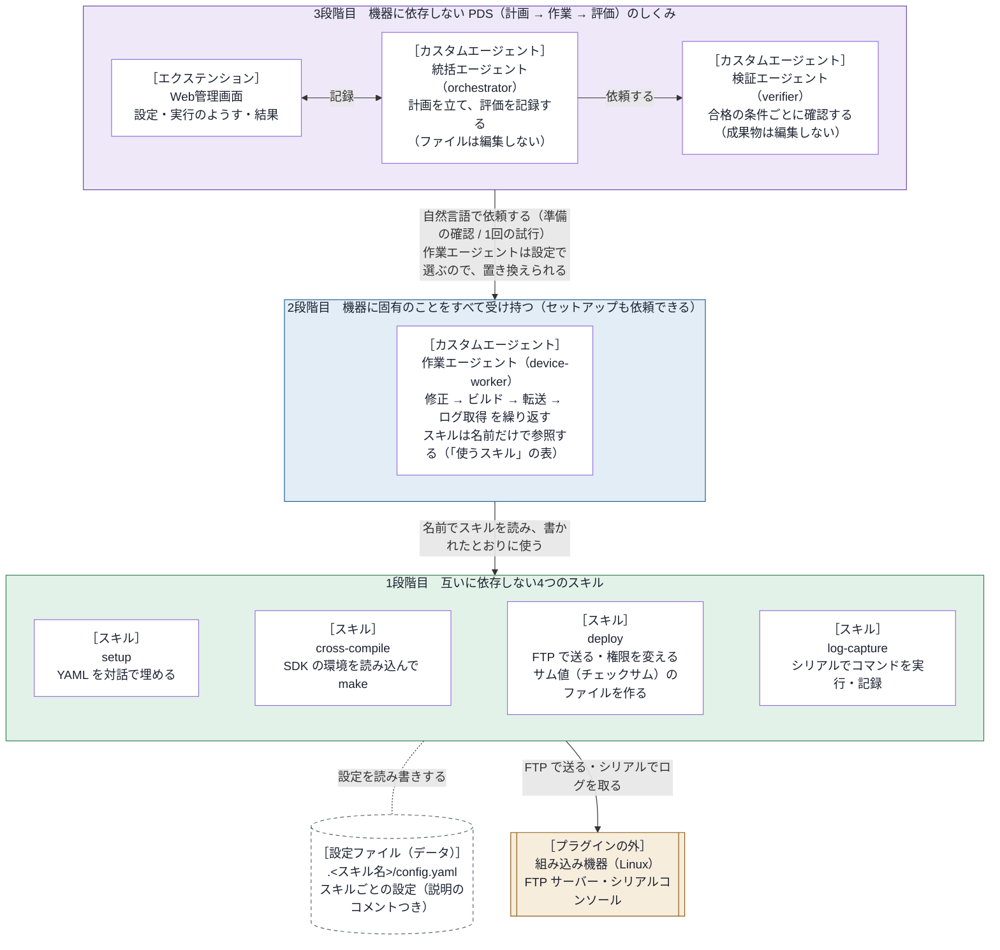

# embedded-debug-loop 設計書

内部のしくみと、部品の間の取り決め（インターフェース）を書く。
利用者から見た振る舞いは [仕様書](../specs/requirements.md) にある。

- バージョン：0.3.0

## 1. 基本の考え方

> **組み込み機器に固有のことは、すべて作業エージェント（`device-worker`）が受け持つ。**

部品は、3つの段階（部品の階層）に分かれる（2章の図）。
上の段階は、下の段階の部品を名前だけで参照する（中身に依存しない）。
そのため、作業エージェントを置き換えれば別の機器でも動き、スキルを置き換えても上の段階は変わらない。
どの段階も、上の段階なしで使える（使い方は 2.1 の表）。

## 2. アーキテクチャ

### 2.1 ブロックごとの置き場所と知識

| ブロック | 置き場所 | 使う Copilot CLI の機能 | 持っている知識 |
| --- | --- | --- | --- |
| Web管理画面 | `extensions/embedded-debug-loop/` | 4章を参照 | 統括エージェント向けのツール、画面、Copilot CLI のイベント。既定の作業エージェントの名前は `defaults.json` にだけ置く |
| 統括エージェント | `agents/orchestrator.agent.md` | `/agent` で選ぶ。`tools`：`agent`（`task` で作業エージェントと検証エージェントを呼ぶ）・`read`・`search`・`ask_user`・エクステンションのツール | PDS の進め方。作業エージェントの名前は設定から受け取る |
| 検証エージェント | `agents/verifier.agent.md` | 統括エージェントが `task` で呼ぶ。`tools`：`read`・`search` | 合格の条件ごとに確認する方法 |
| 作業エージェント | `agents/device-worker.agent.md` | `/agent` で選ぶか、`task` で呼ばれる。`tools`：`read`・`edit`・`search`・`execute`・`skill`・`ask_user` | スキルの名前と役割（「使うスキル」の表） |
| 4つのスキル | `skills/<スキル名>/` | `/embedded-debug-loop:<スキル名>`（フォルダだけをコピーしたときは `/<スキル名>`）か `skill` ツール。スクリプトはシェルのツールで実行する。setup は `ask_user` で質問する | 自分のことだけ。setup は、値の意味を YAML のコメントから読み取る |

- `agents/` と `extensions/` は、`com.github.copilot/` の下にある。
- スキルのフォルダには、`SKILL.md`、`scripts/` の Python のスクリプト（setup は `config_tool.py`、cross-compile は `build.py`、deploy は `deploy.py`、log-capture は `capture.py`）、使い方の `README.md`、`tests/` がある。setup のほかは、設定のひな形 `config-template.yaml` も持つ。
- 使っていない部品：MCP サーバー、プラグインのフックの設定（`hooks.json`。フックはエクステンションで登録する）、LSP、指示ファイル。
- スキルのスクリプトは、Python 3 の標準ライブラリだけで書く。マニフェストは `plugin.json`（Agent Plugins の形式）。

## 3. 部品の間の取り決め

### 3.1 作業エージェントとスキル

作業エージェントは、スキルを `skill` ツールで読み、`SKILL.md` のとおりに使う。
スクリプトの名前も `SKILL.md` から知る（作業エージェントの定義には書かない）。
ビルド・転送・ログ取得のスクリプトは、次のサブコマンドを持つ。

| 用途 | 呼び方 | 返す JSON（主なキー） |
| --- | --- | --- |
| 作業 | `<スクリプト> run` | `ok`、`message`、`log`、スキルごとの結果 |
| 設定ファイルの場所 | `<スクリプト> config-path` | `config`、`created`、`missing` |
| 設定の確認 | `<スクリプト> check` | `ok`、`problems`、`summary` |

- 標準出力に JSON を1つだけ出す。経過は標準エラーに出す。
- 終了コード：0 は成功、1 は作業の失敗、2 は設定の問題（`check` では、機器に接続できないときも 2）。
- `config-path` は、ふつう 0（足りない項目は `missing`、読めないなどの問題は `problems` に入れる）。作業フォルダがない、設定ファイルを作れないなど、続けられないときは 2 を返すスキルもある。引数の誤りは 2。

### 3.2 設定ファイル

- 置き場所：作業フォルダ（ふつうは、Copilot CLI を起動したフォルダ）の `.<スキル名>/config.yaml`。ログは `.<スキル名>/logs/`。フォルダには `.gitignore`（中身は `*`）を作る。
- スクリプトは、カレントディレクトリを作業フォルダとする。`--workdir` で作業フォルダを、`--config` で設定ファイルを変えられる。
- スキル名は、スクリプトのパスから求めたスキルのフォルダの名前（別の名前でコピーすれば、その名前）。プラグインの名前は使わない（3.3）。
- スキル名は、結果の JSON の `skill`、ログファイルの名前の先頭、経過の先頭の `[名前]`（付けるスキルだけ）にも使う。
- 形式：入れ子のない `項目: 値`。値は、文字列・数値・true/false・null・文字列のリスト。各項目のすぐ上に `#` で説明を書く。
- 設定ファイルがなければ、ひな形をコピーして作る。YAML を読むコードは、スキルごとに持つ。

setup は、設定ファイルを持たず、ほかのスキルを参照しない。この形式のファイルなら、どれにでも値を入力できる。
ファイルの指定がなければ、作業フォルダとその下3段までから、項目の上に `#` の説明がある YAML を探して候補にする。
`.git`・`node_modules` などと、スキルのフォルダ（`SKILL.md` があるフォルダ）は探さない。点（.）で始まるほかのフォルダは探す。

### 3.3 スキルのフォルダ

スキルのフォルダは、それだけで完結させる。プラグインをインストールせず、フォルダだけをコピーして使う人がいるためである。
フォルダの中のファイル（コメントとエラーメッセージを含む）には、次を書かない：プラグインの名前とその略、ほかのスキル・エージェント・Web管理画面・エクステンション、フォルダの外を指すパス。

### 3.4 統括エージェントと作業エージェント

2つのエージェントは、自然言語の依頼だけでやり取りする。依頼は2種類ある。

| 依頼 | 作業エージェントの応答 |
| --- | --- |
| 準備の確認（作業はしない） | 1行目が「準備：できている」か「準備：できていない」。続けて、設定の要約と足りないもの |
| 試行（1回だけ。合否は判断しない） | 試行の番号、変えたこと、ビルド・転送・ログ取得の結果、ログの要点、ログの場所、気づいたこと |

作業エージェントは、次のどちらかに当たれば、ほかのエージェントからの依頼として扱う。依頼されたことだけを行い、利用者には質問しない。

- `ask_user` が使えない。Copilot CLI は、`task` で呼ばれたサブエージェントに `ask_user` を渡さない（1.0.98 と 1.0.102 で確認）。
- 依頼の文が「これは準備の確認です」か「あなたは作業役です」で始まる（統括エージェントの依頼のひな形の書き出し）。

### 3.5 統括エージェントとエクステンション

| 統括エージェントが使うツール（名前の頭は `embedded-debug-loop_`） | 呼ぶとき | すること |
| --- | --- | --- |
| `open` | 依頼を受けたとき | 画面のサーバーを起動し、依頼と合格の条件を「開始」前の下書きに入れ、今の設定を返す。作業エージェントの名前を渡されたら、設定に保存する |
| `prepare` | 準備の確認の応答を受けたとき | 応答を Web管理画面の「設定」に出す |
| `plan` | 試行の始め | 計画を記録する |
| `study` | 評価の後 | 条件ごとの合否と、次にすることを記録する |
| `finish` | 終わるとき | 結論と振り返りを記録する |
| `issue` | 利用者が Issue の作成に同意したとき | `gh` で Issue を作成する |

「開始」の後、エクステンションは次のことをする。

- `session.send` で開始のメッセージをチャットに送る。統括エージェントは、これを受けて試行を始める。
- 作業エージェントと検証エージェントのモデルと考える深さを、`tools.updateSubagentSettings` で設定する（定義ファイルは書き換えない）。
- 2つのエージェントの応答を、フック `onSubagentStop` で受け取り、試行の記録に入れる。
- フック `onPreToolUse` で、統括エージェントのファイル編集（edit など）・コマンド（bash など）・スキル（skill）のツールを拒否する。
- 作業の報告がある試行で、新しい計画なしに作業エージェントを呼ぶことも拒否する（報告と評価が食い違うため）。

「止める」が押されたら、`session.abort()` で今の応答を止める。その後は、`embedded-debug-loop_finish` 以外のツールをすべて拒否する。
統括エージェントが終わりを記録せずに止まったら、エクステンションが結論を書く。結論には、止めた試行の番号と工程（計画・作業・評価）と、編集のツール（edit・create・apply_patch）で変えたファイルを書く。変えたファイルは元に戻さない。

試行の記録に入れなかった作業・検証エージェントの応答（止めた後や、計画の記録の前に届いたものなど）は、理由を付けて `events.jsonl`（4章）にだけ残す。

#### 統括エージェントの tools の制限

統括エージェントにファイル編集・コマンド・スキルを使わせないため、3つの対策を重ねる。
定義の `tools` を絞るだけでは足りない。`tools` に `skill` がなくても、Copilot CLI は `skill` のツールとスキルの一覧を渡すためである。

1. 定義の `tools` を、エージェントの呼び出し・読み取り・検索・質問・記録のツールに絞る。
2. 定義で、自分では作業しない（ファイルを編集しない、コマンドを実行しない）と指示する。作業の方法と、作業エージェントの応答に出た道具・スキル・設定ファイル・手順の名前も、計画や依頼に書かせない。
3. 「開始」の後は、エクステンションがこれらのツールを拒否する。

なお、Copilot CLI 1.0.105 では、統括エージェントの `tools` を絞っても、それが呼ぶ作業エージェントは自分の `tools` を使えた（テストで確認）。

## 4. エクステンションの中

追加のパッケージは使わない。

| ファイル | 役目 |
| --- | --- |
| `extension.mjs` | 入口。Copilot SDK の `joinSession` を `adapter.mjs` に渡す。SIGTERM・SIGINT では、記録を書き終え、サーバーを閉じて終わる |
| `adapter.mjs` | Copilot CLI との接続部分。ツール・フック・イベント（`session.on`）を登録する。`session` の `send`・`abort`・`log`（チャットへの通知）・`rpc`（エージェントとモデルの一覧、エージェントの切り替え、サブエージェントの設定）を `core/control.mjs` に渡す |
| `defaults.json` | 既定の値（3つのエージェントの名前、繰り返しの上限、Issue の作成先）。コードには書かない |
| `core/messages.mjs` | モデルと利用者に見せる文 |
| `core/store.mjs` | 状態（設定・下書き・今の実行・過去の実行の一覧）と、画面に渡すスナップショット |
| `core/persist.mjs` | 記録のファイルの読み書き |
| `core/tools.mjs` | 6つのツール（3.5） |
| `core/events.mjs` | イベントから、試行の記録、動いているエージェント、入力待ち（質問・許可）の通知、画面の「くわしい記録」の行を作る |
| `core/guard.mjs` | `onPreToolUse` で拒否するかを決める（3.5） |
| `core/control.mjs` | 画面からの操作（下の API） |
| `ui/server.mjs` | 画面のサーバー。127.0.0.1 だけで待ち受け、トークン（URL の `k` か、初回に渡すクッキー）が合わない要求を拒否する |
| `ui/static/` | 画面（`index.html`・`app.js`・`style.css`）。状態を 1.5 秒ごと（隠れているときは 5 秒ごと）に読む |

画面のサーバーの API：

| API | すること |
| --- | --- |
| `GET /api/state` | スナップショット（選べるエージェントとモデルを含む）を返す |
| `POST /api/settings` | 設定を保存する |
| `POST /api/start` | 開始する |
| `POST /api/stop` | 止める |
| `GET /api/runs/<実行の番号>` | 過去の実行の記録を返す |

記録の置き場所は `<COPILOT_HOME または ~/.copilot>/plugin-data/embedded-debug-loop/`。

- `settings.json`：Web管理画面の設定。`folders` のキーが作業フォルダのパス、値がその設定。
  - この作業フォルダは、セッションの作業フォルダ（`/cd` で変わる）。取得できなければ、エクステンションのプロセスの今のフォルダ（`process.cwd()`）。
  - 設定がなければ、`defaults.json` の値を使う。フォルダで分けていない古い形式は読まない。
- `runs/<実行の番号>/run.json`：実行の記録。
- `runs/<実行の番号>/events.jsonl`：イベントのログ（1行に1件の JSON。拒否したツールなども残す）。振り返りに使う。

## 5. テスト

プラグインのフォルダで `python3 tests/run.py` を実行すると、すべてのテストが動く。
すべて合格なら終了コード 0、不合格か動かせないテストがあれば 1。

| テスト | 置き場所 | 確認すること |
| --- | --- | --- |
| スキル | `skills/<スキル名>/tests/` | スクリプトの振る舞い（テストの中で立てる FTP サーバーと、模擬のシリアルコンソールを使う）。フォルダだけをコピーしても、`python3 -m unittest discover -s tests` で動く |
| 独立性 | `tests/independence/` | 段階をまたぐ依存がない。スキルのフォルダが 3.3 の決まりを守る。スキルのフォルダ1つだけを（名前を変えても）コピーして動き、データは `.<フォルダの名前>/` にだけできる |
| エクステンション | `tests/extension/` | 模擬のセッションで、ツール・開始・イベント・停止・API・`onPreToolUse` の拒否。模擬の DOM で、画面（`app.js`）。3段階目の独立性（作業の中身を参照せず、`defaults.json` の作業エージェントの名前を置き換えても動く） |
