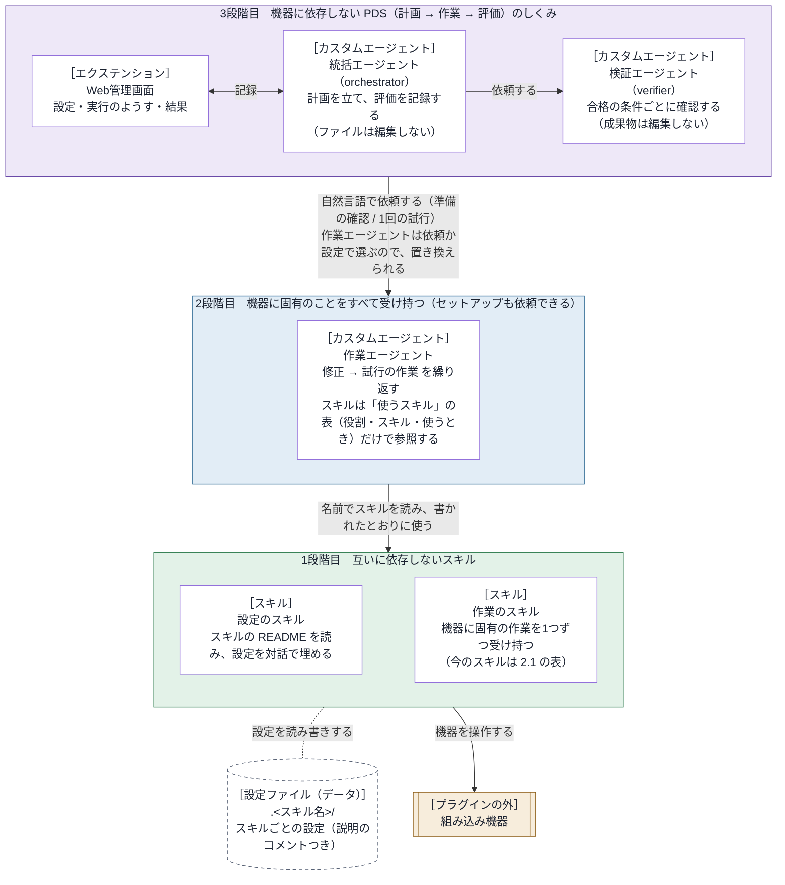

# embedded-debug-loop 設計書

内部のしくみと、部品の間の取り決め（インターフェース）を書く。
利用者から見た振る舞いは [仕様書](../specs/requirements.md) にある。

- バージョン：0.3.0

## 1. 基本の考え方

> **組み込み機器に固有のことは、すべて作業エージェントが受け持つ。**

部品は、3つの段階（部品の階層）に分かれる（2章の図）。
上の段階は、下の段階の部品を名前だけで参照する（中身に依存しない）。
そのため、作業エージェントを置き換えれば別の機器でも動き、スキルを置き換えても上の段階は変わらない。
どの段階も、上の段階なしで使える（使い方は 2.1 の表）。
文書も同じ考え方で分ける。各部品の使い方は、その部品の README にだけ書く（3.7）。

## 2. アーキテクチャ

### 2.1 ブロックごとの置き場所と知識

| ブロック | 置き場所 | 使う Copilot CLI の機能 | 持っている知識 |
| --- | --- | --- | --- |
| Web管理画面 | `extensions/embedded-debug-loop/` | 4章を参照 | 統括エージェント向けのツール、画面、Copilot CLI のイベント。既定の作業エージェントの名前は `defaults.json` にだけ置く |
| 統括エージェント | `agents/orchestrator.agent.md` | `/agent` で選ぶ。`tools`：`agent`（`task` で作業エージェントと検証エージェントを呼ぶ）・`read`・`search`・`ask_user`・エクステンションのツール | PDS の進め方。作業エージェントの名前は設定から受け取る |
| 検証エージェント | `agents/verifier.agent.md` | 統括エージェントが `task` で呼ぶ。`tools`：`read`・`search` | 合格の条件ごとに確認する方法 |
| 作業エージェント | `agents/<作業エージェントの名前>.agent.md` | `/agent` で選ぶか、`task` で呼ばれる。`tools`：`read`・`edit`・`search`・`execute`・`skill`・`ask_user` | スキルの名前と役割（「使うスキル」の表） |
| スキル | `skills/<スキル名>/` | `/embedded-debug-loop:<スキル名>`（フォルダだけをコピーしたときは `/<スキル名>`）か `skill` ツール。スクリプトはシェルのツールで実行する。設定のスキルは `ask_user` で質問する | 自分のことだけ。設定のスキルは、設定するスキルを探し、そのスキルの README と設定ファイルのコメントから、設定の内容を読み取る（3.3） |

- `agents/` と `extensions/` は、`com.github.copilot/` の下にある。
- スキルのフォルダには、`SKILL.md`、`scripts/` の Python のスクリプト、使い方の `README.md`、`tests/` がある。設定を持つスキルは、設定のひな形も持つ。
- 設計書には、スキルと作業エージェントの名前と中身を書かない。各スキルの中身は、そのスキルの README と SKILL.md にある。
- 作業エージェントの使い方は `agents/README.markdown` に書く。拡張子が `.md` だと、Copilot CLI がエージェントの定義として読み込み、エラーを出す（1.0.105 で確認）。`.markdown` は読み込まれない（1.0.105 で、プロジェクトの `.github/agents/` とプラグインの `com.github.copilot/agents/` の両方で確認）。
- 使っていない部品：MCP サーバー、プラグインのフックの設定（`hooks.json`。フックはエクステンションで登録する）、LSP、指示ファイル。
- スキルのスクリプトは、Python 3.8 以上の標準ライブラリだけで書く。ほかのものが要るスキルは、`scripts/vendor/` に同梱し、自分のフォルダの `vendor` を `sys.path` の先頭に足して使う。マニフェストは `plugin.json`（Agent Plugins の形式）。

## 3. 部品の間の取り決め

### 3.1 作業エージェントとスキル

作業エージェントは、スキルを `skill` ツールで読み、`SKILL.md` のとおりに使う。
スクリプトの名前も `SKILL.md` から知る（作業エージェントの定義には書かない）。
作業エージェントがスキルに頼むのは、作業と設定の確認だけである。設定は、設定のスキルに任せる（3.3）。

作業エージェントの定義は、スキルを「使うスキル」の表にだけ書く。

| 列 | 意味 |
| --- | --- |
| 役割 | スキルの役割。試行の報告の行の名前にも使う |
| スキル | skill ツールに渡す名前 |
| 使うとき | 「試行」：試行のたびに、表の上から順に使う。「設定」：設定のスキル。それ以外：書いた条件のときに使う |

- 定義の手順は、この表の列だけを見て動く（「作業のスキル」「試行の作業」など）。表の外に、スキルの名前と役割の並びを書かない。
- そのため、スキルを足す・消す・置き換えるとき、作業エージェントで直すのは表の行だけである。

スキルのスクリプトとコマンドは、そのスキルの SKILL.md と README に書く。作業エージェントと設計書には書かない。

### 3.2 設定ファイル

- 置き場所：作業フォルダ（ふつうは、Copilot CLI を起動したフォルダ）の `.<スキル名>/`。ログは `.<スキル名>/logs/`。フォルダには `.gitignore`（中身は `*`）を作る。
- スキル名は、スキルのフォルダの名前（別の名前でコピーすれば、その名前）。プラグインの名前は使わない（3.4）。
- 形式と項目は、スキルが決め、README に書く。各項目のすぐ上に説明のコメントを書く（設定のスキルが読む）。

### 3.3 設定のスキルとほかのスキル

設定のスキルは、設定ファイルを持たず、特定のスキルの名前・項目・置き場所を知らない。
名前を渡されたスキルを探し、その README（なければ SKILL.md）と設定ファイルのコメントだけを頼りに、利用者に聞きながら設定を埋める。
スキルを探す場所と順、聞く順は、設定のスキルの SKILL.md にある。

### 3.4 スキルのフォルダ

スキルのフォルダは、それだけで完結させる。プラグインをインストールせず、フォルダだけをコピーして使う人がいるためである。
フォルダの中のファイル（コメントとエラーメッセージを含む）には、次を書かない：プラグインの名前とその略、ほかのスキル・エージェント・Web管理画面・エクステンション、フォルダの外を指すパス。

### 3.5 統括エージェントと作業エージェント

2つのエージェントは、自然言語の依頼だけでやり取りする。依頼は2種類ある。

| 依頼 | 作業エージェントの応答 |
| --- | --- |
| 準備の確認（作業はしない） | 1行目が「準備：できている」か「準備：できていない」。続けて、設定の要約と足りないもの |
| 試行（1回だけ。合否は判断しない） | 試行の番号、変えたこと、使ったスキルごとの結果（「<役割>：できた／できなかった」）、ログの要点、ログの場所、気づいたこと |

作業エージェントは、次のどちらかに当たれば、ほかのエージェントからの依頼として扱う。依頼されたことだけを行い、利用者には質問しない。

- `ask_user` が使えない。Copilot CLI は、`task` で呼ばれたサブエージェントに `ask_user` を渡さない（1.0.98 と 1.0.102 で確認）。
- 依頼の文が「これは準備の確認です」か「あなたは作業役です」で始まる（統括エージェントの依頼のひな形の書き出し）。

準備の確認は、`open`（3.6）が返した作業エージェントに頼む。
`open` が返すのは、依頼に書かれた名前、なければ作業フォルダの設定の名前、それもなければ `defaults.json` の名前である。
Web管理画面で替えたときは、替えた作業エージェントの準備の確認がまだないので、「開始」の知らせで確認させる。

### 3.6 統括エージェントとエクステンション

| 統括エージェントが使うツール（名前の頭は `embedded-debug-loop_`） | 呼ぶとき | すること |
| --- | --- | --- |
| `open` | 依頼を受けたとき | 画面のサーバーを起動し、依頼と合格の条件を「開始」前の下書きに入れ、今の設定を返す。作業エージェントの名前を渡されたら、設定に保存する |
| `prepare` | 準備の確認の応答を受けたとき | 応答を Web管理画面の「設定」に出す |
| `plan` | 試行の始め | 計画を記録する |
| `study` | 評価の後 | 条件ごとの合否と、次にすることを記録する |
| `finish` | 終わるとき | 結論と振り返りを記録する |
| `issue` | 利用者が Issue の作成に同意したとき | `gh` で Issue を作成する |

「開始」の後、エクステンションは次のことをする。

- `session.send` で開始のメッセージをチャットに送る。統括エージェントは、これを受けて試行を始める。
- 作業エージェントと検証エージェントのモデルと考える深さを、`tools.updateSubagentSettings` で設定する（定義ファイルは書き換えない）。
- 2つのエージェントの応答を、フック `onSubagentStop` で受け取り、試行の記録に入れる。
- フック `onPreToolUse` で、統括エージェントのファイル編集（edit など）・コマンド（bash など）・スキル（skill）のツールを拒否する。
- 作業の報告がある試行で、新しい計画なしに作業エージェントを呼ぶことも拒否する（報告と評価が食い違うため）。

「止める」が押されたら、`session.abort()` で今の応答を止める。その後は、`embedded-debug-loop_finish` 以外のツールをすべて拒否する。
統括エージェントが終わりを記録せずに止まったら、エクステンションが結論を書く。結論には、止めた試行の番号と工程（計画・作業・評価）と、編集のツール（edit・create・apply_patch）で変えたファイルを書く。変えたファイルは元に戻さない。

試行の記録に入れなかった作業・検証エージェントの応答（止めた後や、計画の記録の前に届いたものなど）は、理由を付けて `events.jsonl`（4章）にだけ残す。

#### 統括エージェントの tools の制限

統括エージェントにファイル編集・コマンド・スキルを使わせないため、3つの対策を重ねる。
定義の `tools` を絞るだけでは足りない。`tools` に `skill` がなくても、Copilot CLI は `skill` のツールとスキルの一覧を渡すためである。

1. 定義の `tools` を、エージェントの呼び出し・読み取り・検索・質問・記録のツールに絞る。
2. 定義で、自分では作業しない（ファイルを編集しない、コマンドを実行しない）と指示する。作業の方法と、作業エージェントの応答に出た道具・スキル・設定ファイル・手順の名前も、計画や依頼に書かせない。
3. 「開始」の後は、エクステンションがこれらのツールを拒否する。

なお、Copilot CLI 1.0.105 では、統括エージェントの `tools` を絞っても、それが呼ぶ作業エージェントは自分の `tools` を使えた（テストで確認）。

### 3.7 文書の置き場所

各部品の使い方は、その部品の README にだけ書く。下の段の部品を置き換えても、上の段の文書を直さずに済むようにするためである。

| 部品 | 文書 | 書くこと |
| --- | --- | --- |
| スキル | `skills/<名前>/README.md` | 何をするか、必要なもの、置き方、呼び方、設定（場所・作り方・項目の意味）、うまくいかないとき、テスト。フォルダだけで読める（3.4） |
| 作業エージェント | `agents/README.markdown` | その作業エージェントのことだけ（何をするか、選び方、頼み方の例、うまくいかないとき）。定義と組で置き換える。使うスキルは、定義の表を案内する（スキルの名前を書かない） |
| 3段階目 | `docs/guide/3-orchestrator.md` | 統括エージェント・検証エージェント・Web管理画面の使い方 |
| プラグイン全体 | `README.md` | 何をするプラグインか、3つの段階と見る README、必要なもの、インストール、開発者向けの文書への案内 |
| 部品を変える | `docs/replace.md` | 開発者向け。スキルを足す・消す・置き換える手順と、作業エージェントを置き換える手順。直すファイルと行を、今の部品の名前を例にして書く |

- 上の段の文書（`README.md`、`3-orchestrator.md`）には、スキルの名前と、転送・ログ取得の具体（FTP、シリアル、COM ポートなど）を、例としても書かない。
- `agents/README.markdown` は、スキルの名前を書かない。転送・ログ取得の具体と、設定の項目も書かない。
- どちらも、独立性のテスト（5章）で確かめる。

### 3.8 Windows への対応

利用者の PC は Windows である。Copilot CLI は、Windows ではコマンドを PowerShell（6 以上）で実行する。Linux でも同じスキルが動く。

| 項目 | 決まり |
| --- | --- |
| SKILL.md のコマンド | bash だけの書き方（ヒアドキュメント、`source`、`$(...)` など）に頼らない。Python は `<python>` と書き、Windows では `py -3`（なければ `python`）、ほかでは `python3` と決める |
| 標準出力 | Windows で出力先がパイプのときは、コンソールの文字コード（`GetConsoleOutputCP`）で書く。PowerShell はこの文字コードで読む（Python 3.15 からの既定の UTF-8 モードのままだと、日本語の Windows では文字化けする）。それ以外は Python の既定の文字コード。JSON は、書けない文字を JSON の `\uXXXX` にしてから書く。経過（標準エラー）は `errors="backslashreplace"` で書く |
| ファイル | 設定ファイルとログは、いつも UTF-8 で読み書きする |
| パス | `os.path`・`pathlib` で扱い、区切りの `/` を決め打ちしない（機器の中のパスは別。機器は Linux） |

スキルのテストは、GitHub Actions の Windows のマシンでも動かす（5章）。Copilot CLI と組み合わせた Windows での動作は、まだ確認していない。

## 4. エクステンションの中

追加のパッケージは使わない。

| ファイル | 役目 |
| --- | --- |
| `extension.mjs` | 入口。Copilot SDK の `joinSession` を `adapter.mjs` に渡す。SIGTERM・SIGINT では、記録を書き終え、サーバーを閉じて終わる |
| `adapter.mjs` | Copilot CLI との接続部分。ツール・フック・イベント（`session.on`）を登録する。`session` の `send`・`abort`・`log`（チャットへの通知）・`rpc`（エージェントとモデルの一覧、エージェントの切り替え、サブエージェントの設定）を `core/control.mjs` に渡す |
| `defaults.json` | 既定の値（3つのエージェントの名前、繰り返しの上限、Issue の作成先）。コードには書かない |
| `core/messages.mjs` | モデルと利用者に見せる文 |
| `core/store.mjs` | 状態（設定・下書き・今の実行・過去の実行の一覧）と、画面に渡すスナップショット |
| `core/persist.mjs` | 記録のファイルの読み書き |
| `core/tools.mjs` | 6つのツール（3.6） |
| `core/events.mjs` | イベントから、試行の記録、動いているエージェント、入力待ち（質問・許可）の通知、画面の「くわしい記録」の行を作る |
| `core/guard.mjs` | `onPreToolUse` で拒否するかを決める（3.6） |
| `core/control.mjs` | 画面からの操作（下の API） |
| `ui/server.mjs` | 画面のサーバー。127.0.0.1 だけで待ち受け、トークン（URL の `k` か、初回に渡すクッキー）が合わない要求を拒否する |
| `ui/static/` | 画面（`index.html`・`app.js`・`style.css`）。状態を 1.5 秒ごと（隠れているときは 5 秒ごと）に読む |

画面のサーバーの API：

| API | すること |
| --- | --- |
| `GET /api/state` | スナップショット（選べるエージェントとモデルを含む）を返す |
| `POST /api/settings` | 設定を保存する |
| `POST /api/start` | 開始する |
| `POST /api/stop` | 止める |
| `GET /api/runs/<実行の番号>` | 過去の実行の記録を返す |

記録の置き場所は `<COPILOT_HOME または ~/.copilot>/plugin-data/embedded-debug-loop/`。

- `settings.json`：Web管理画面の設定。`folders` のキーが作業フォルダのパス、値がその設定。Windows では、パスの大文字と小文字を区別しない。
  - この作業フォルダは、セッションの作業フォルダ（`/cd` で変わる）。取得できなければ、エクステンションのプロセスの今のフォルダ（`process.cwd()`）。
  - 設定がなければ、`defaults.json` の値を使う。フォルダで分けていない古い形式は読まない。
- `runs/<実行の番号>/run.json`：実行の記録。
- `runs/<実行の番号>/events.jsonl`：イベントのログ（1行に1件の JSON。拒否したツールなども残す）。振り返りに使う。

## 5. テスト

プラグインのフォルダで `python3 tests/run.py`（Windows では `py -3 tests/run.py`）を実行すると、すべてのテストが動く。
すべて合格なら終了コード 0、不合格か動かせないテストがあれば 1。

| テスト | 置き場所 | 確認すること |
| --- | --- | --- |
| スキル | `skills/<スキル名>/tests/` | スクリプトの振る舞い。フォルダだけをコピーしても、`python -m unittest discover -s tests` で動く |
| 独立性 | `tests/independence/` | 段階をまたぐ依存がない。スキルのフォルダが 3.4 の決まりを守る。スキルのフォルダ1つだけをコピーしても、そのスキルのテストが通る（データの置き場所などは、各スキルのテストで確かめる）。上の段の文書に下の段の中身がない（3.7）。スキルの一覧は `skills/` の下のフォルダから、作業エージェントは `defaults.json` から、設定のスキルと作業のスキルは「使うスキル」の表から読む（テストに部品の名前を書かない） |
| エクステンション | `tests/extension/` | 模擬のセッションで、ツール・開始・イベント・停止・API・`onPreToolUse` の拒否。模擬の DOM で、画面（`app.js`）。3段階目の独立性（作業の中身を参照せず、`defaults.json` の作業エージェントの名前を置き換えても動く） |

GitHub Actions（リポジトリの根の `.github/workflows/embedded-debug-loop.yml`）でも、次のテストを自動で動かす。

| ジョブ | マシン | 動かすもの |
| --- | --- | --- |
| スキル | `windows-latest`・`ubuntu-24.04` × Python 3.8・3.12 | `skills/` の下の、`tests/` があるすべてのスキルのテスト（スキルのフォルダで `python -m unittest discover -s tests`） |
| 独立性 | `windows-latest`・`ubuntu-24.04` × Python 3.12 | `tests/independence/` |
| Web管理画面 | `windows-latest`・`ubuntu-24.04` × Node 20 | `tests/extension/` |

- スキルと独立性のジョブでは、各スキルの `tests/requirements.txt` にあるパッケージを入れる。CI の定義に、スキルの名前とパッケージの名前を書かない。
- 設定のスキルを PowerShell から使うテスト（標準入力と文字コード）は、そのスキルの `tests/` に置き、Windows のスキルのジョブで動く。
- Linux は `ubuntu-24.04` に固定する。`ubuntu-latest` は 2026年10月から Ubuntu 26 に移り、Python 3.8 を入れられないおそれがある。
