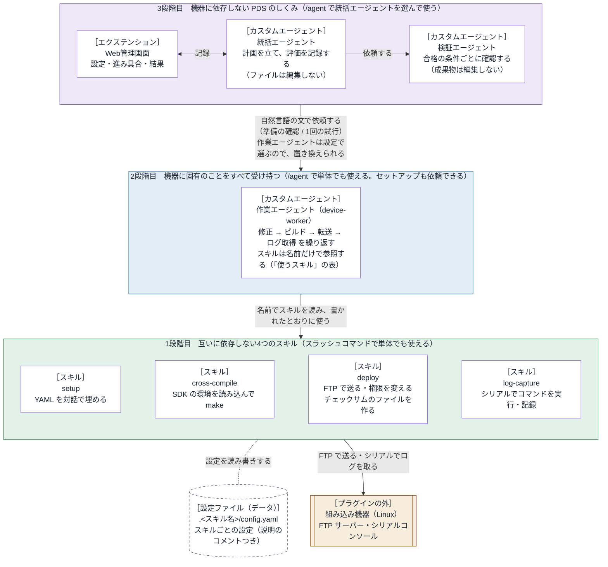

# embedded-debug-loop 設計書

この文書には、embedded-debug-loop の内部のしくみと、部品の間の取り決め（インターフェース）を書く。
利用者から見た振る舞いは [仕様書](../specs/requirements.md) にある。

- バージョン：0.3.0

## 1. 基本の考え方

> **組み込み機器に固有のことは、すべて作業エージェント（2段階目）が受け持つ。**

部品は、次の3つの段階に分かれる。段階は、作業の順番ではなく、部品の階層を表す。

| 段階 | 部品 | 役目 |
| --- | --- | --- |
| 3段階目 | 統括エージェント（`orchestrator`）、検証エージェント（`verifier`）、Web管理画面 | 計画 → 作業 → 評価 の試行を繰り返す（PDS サイクル。Plan・Do・Study） |
| 2段階目 | 作業エージェント（`device-worker`） | 機器に固有の作業（ソースの修正 → ビルド → 転送 → ログ取得）を受け持つ |
| 1段階目 | 4つのスキル：setup（設定）、cross-compile（ビルド）、deploy（転送）、log-capture（ログ取得） | 設定・ビルド・転送・ログ取得を、1つずつ受け持つ |

- 3段階目は、機器に固有のことを持たない。そのため、どの機器にも使える。
- 3段階目は、作業エージェントに自然言語の文で依頼するだけである。作業エージェントを置き換えれば、別の機器でも動く。
- 2段階目の作業エージェントは、使うスキルの名前と役割だけを参照する。スキルの中身には依存しない。
- 1段階目のスキルは、互いに参照しない。どれも単体で使える。スキルを置き換えても、上の段階は変わらない。
- どの段階も、それより上の段階なしで使える。1段階目はスラッシュコマンドで使う。2段階目と3段階目は、`/agent` で選んで使う。

## 2. アーキテクチャ

上の段階は、下の段階の部品（作業エージェント、スキル）を名前だけで参照する。中身には依存しない。

- 実線の矢印は、依頼する・使う向きを表す。両向きの矢印は、記録のやり取りを表す。点線は、設定ファイルの読み書きを表す。
- 図の［ ］は、そのブロックがどの種類の部品（スキル、カスタムエージェント、エクステンションなど）でできているかを表す。

### 2.1 ブロックごとの部品と置き場所

| ブロック（図） | 部品の種類 | 置き場所 | 使っている Copilot CLI の機能 | 持っている知識 |
| --- | --- | --- | --- | --- |
| Web管理画面 | エクステンション | `com.github.copilot/extensions/embedded-debug-loop/`（入口は `extension.mjs`。既定の値は `defaults.json`） | 表の下の「エクステンションが使う機能」を参照 | 統括エージェント向けのツール、画面、Copilot CLI のイベント。既定の作業エージェントの名前はコードに書かず、`defaults.json`（データ）にだけ置く |
| 統括エージェント | カスタムエージェント | `com.github.copilot/agents/orchestrator.agent.md` | `/agent` で選ぶメインのエージェント。`tools`：`agent`（`task` で作業エージェントと検証エージェントを呼ぶ）・`read`・`search`・`ask_user`・エクステンションのツール6つ | PDS の進め方。作業エージェントの名前は、設定から受け取る |
| 検証エージェント | カスタムエージェント | `com.github.copilot/agents/verifier.agent.md` | 統括エージェントから `task` で呼ばれるサブエージェント。`tools`：`read`・`search` | 合格の条件ごとに確認する方法 |
| 作業エージェント | カスタムエージェント | `com.github.copilot/agents/device-worker.agent.md` | `/agent` で選ぶメインのエージェント。または、統括エージェントから `task` で呼ばれるサブエージェント。`tools`：`read`・`edit`・`search`・`execute`・`skill`（スキルを読む）・`ask_user` | スキルの名前と役割（「使うスキル」の表） |
| setup | スキル（`SKILL.md`、Python のスクリプト、使い方の `README.md`、テスト） | `skills/setup/`（`scripts/config_tool.py`、`tests/`） | スラッシュコマンド `/embedded-debug-loop:setup` か、`skill` ツール。フォルダだけをコピーしたときは `/setup`。質問は `ask_user` で行う | 自分のことだけ。入力する値の意味は、YAML の各項目のコメントから読み取る |
| cross-compile | スキル（`SKILL.md`、Python のスクリプト、設定のひな形、使い方の `README.md`、テスト） | `skills/cross-compile/`（`scripts/build.py`、`config-template.yaml`、`tests/`） | スラッシュコマンド `/embedded-debug-loop:cross-compile` か、`skill` ツール。フォルダだけをコピーしたときは `/cross-compile`。スクリプトは、シェルのツールで実行する | 自分のことだけ |
| deploy | スキル（cross-compile と同じ構成） | `skills/deploy/`（`scripts/deploy.py`、`config-template.yaml`、`tests/`） | スラッシュコマンド `/embedded-debug-loop:deploy` か、`skill` ツール。フォルダだけをコピーしたときは `/deploy` | 自分のことだけ |
| log-capture | スキル（cross-compile と同じ構成） | `skills/log-capture/`（`scripts/capture.py`、`config-template.yaml`、`tests/`） | スラッシュコマンド `/embedded-debug-loop:log-capture` か、`skill` ツール。フォルダだけをコピーしたときは `/log-capture` | 自分のことだけ |
| 設定ファイル | 部品ではない（利用者のデータ） | 作業フォルダの `.<スキル名>/config.yaml`（ログは `.<スキル名>/logs/`） | — | — |
| 組み込み機器 | プラグインの外 | — | — | — |

エクステンションが使う機能：

- ツール：統括エージェント向けの6つ（`embedded-debug-loop_open`・`_prepare`・`_plan`・`_study`・`_finish`・`_issue`）
- フック：次の2つ
  - `onPreToolUse`：「開始」を押した後、統括エージェントがファイル編集・コマンド・スキルのツールを使うのを拒否する
  - `onSubagentStop`：作業エージェントと検証エージェントの応答を受け取る
- イベントの受け取り（`session.on`）
- `session.send`：開始のメッセージをチャットに送る
- `session.abort`：応答を止める
- `session.log`：チャットに通知を出す
- `session.rpc`：エージェントの一覧と切り替え、モデルの一覧、サブエージェントのモデルと考える深さの設定（`tools.updateSubagentSettings`）
- そのほか、127.0.0.1 で HTTP サーバーを動かし、Web管理画面を出す

そのほかの決まり：

- 使っていない部品：MCP サーバー（`mcp.json`）、プラグインのフックの設定（`hooks.json`。フックはエクステンションの中で登録する）、LSP、指示ファイル（`copilot-instructions.md` など）。
- スキルのスクリプトは、Python 3 の標準ライブラリだけで書いている。追加のパッケージは要らない。
- プラグインのマニフェストは `plugin.json`（Agent Plugins の形式）である。

## 3. 部品の間の取り決め

### 3.1 作業エージェントとスキル

作業エージェントは、スキルを `skill` ツールで読み、`SKILL.md` に書かれたとおりに使う。
ビルド・転送・ログ取得のスキルのスクリプトは、次の3つのサブコマンドを持つ。

| 用途 | 呼び方 | 返す JSON（主なキー） |
| --- | --- | --- |
| 作業 | `<スクリプト> run` | `ok`、`message`、`log`、スキルごとの結果 |
| 設定ファイルの場所 | `<スクリプト> config-path` | `config`、`created`、`missing` |
| 設定の確認 | `<スクリプト> check` | `ok`、`problems`、`summary` |

- スクリプトは、標準出力に JSON を1つだけ出す。経過は標準エラーに出す。
- 終了コードは、次のとおり。
  - 0：成功した。
  - 1：作業（ビルド・転送・ログ取得）が失敗した。
  - 2：設定に問題がある。`check` では、機器に接続できないときも 2 を返す。
  - `config-path` は、設定ファイルの中身に問題があっても 0 を返す。足りない項目は JSON の `missing` に、読めない所などの問題は `problems` に入れる。コマンドの引数が誤っているときは 2 を返す。
- 作業エージェントの定義には、スクリプトの名前を書かない。作業エージェントは、`SKILL.md` を読んでスクリプトの名前を知る。

### 3.2 設定ファイル

設定ファイルは、ビルド・転送・ログ取得のスキルごとに、作業フォルダに置く。setup は、どのスキルの設定ファイルにも値を入力できる。

#### 置き場所

- 置き場所は `<作業フォルダ>/.<スキルの名前>/config.yaml`。ログは `.<スキルの名前>/logs/` に置く。
- `.<スキルの名前>/` フォルダには、`.gitignore`（中身は `*`）を作る。
- スキルの名前は、スキルのフォルダの名前である。
  - スクリプトは、自分のファイルのパスから、スキルのフォルダの名前を求める。
  - スキルのフォルダを別の名前でコピーすると、設定のフォルダも `.<新しい名前>/` になる。
- スキルのフォルダだけをコピーして使う人は、プラグインをインストールしていない。そのため、設定のフォルダの名前に、プラグインの名前は使わない。
- 作業フォルダは、スクリプトを実行したときのカレントディレクトリ。ふつうは、Copilot CLI を起動したプロジェクトのフォルダになる。
- 作業フォルダは `--workdir` で、設定ファイルは `--config` で変えられる。
- スキルのフォルダの名前は、次の場所にも使う。
  - 結果の JSON の `skill` の値
  - ログファイルの名前の先頭
  - 標準エラーに出す経過の先頭の `[名前]`（付けるスキルだけ）

#### 形式

- 形式は、入れ子のない `項目: 値`。値は、文字列・数値・true/false・null・文字列のリストのどれか。
- 各項目のすぐ上に、`#` のコメントで説明を書く。
- ビルド・転送・ログ取得のスキルは、自分のフォルダに `config-template.yaml`（ひな形）を持つ。設定ファイルがなければ、ひな形をコピーして作る。
- YAML を読むコードは、スキルごとに持つ（共有しない）。追加のパッケージは使わない。

#### setup スキル

- setup は、ひな形も設定ファイルも持たない。
- setup は、この形式のファイルなら、どれにでも値を入力できる。ほかのスキルを参照しない。
- setup は、ファイルが指定されていないときは、作業フォルダから候補を探す。候補は、項目のすぐ上に `#` の説明がある YAML ファイル。
  - 探すのは、作業フォルダと、その下3段までのフォルダ。
  - `.git`・`node_modules` などのフォルダと、スキルのフォルダ（`SKILL.md` があるフォルダ）の中は探さない。
  - それ以外の、名前が点で始まるフォルダ（`.<スキルの名前>/` など）の中は探す。

### 3.3 スキルのフォルダ

スキルのフォルダは、それだけで完結させる。
利用者は、プラグインをインストールせずに、フォルダだけをコピーして使うことがある。

フォルダの中のどのファイル（`SKILL.md`、`README.md`、スクリプト、ひな形、テスト）にも、コメントやエラーメッセージを含めて、次のことを書かない。

- プラグインの名前と、その略
- ほかのスキル
- エージェント
- Web管理画面
- エクステンション
- フォルダの外を指すパス

そのほかの決まり：

- 人向けの使い方は、フォルダの `README.md` に書く。
- テストは、フォルダの `tests/` に置く。スキルのフォルダで `python3 -m unittest discover -s tests` を実行して動かす。

### 3.4 統括エージェントと作業エージェント

2つのエージェントは、自然言語の依頼の文だけでやり取りする。依頼は2種類ある。

| 依頼 | 作業エージェントの応答 |
| --- | --- |
| 準備の確認（作業はしない） | 1行目が「準備：できている」か「準備：できていない」。続けて、設定の要約と足りないもの |
| 試行（1回だけ。合否は判断しない） | 試行の番号、変えたこと、ビルド・転送・ログ取得の結果、ログの要点、ログの場所、気づいたこと |

作業エージェントは、次のどちらかに当たれば、ほかのエージェントからの依頼として扱う。
そのときは、依頼の文に書かれたことだけを行い、利用者には質問しない。

- 質問のツール（`ask_user`）が使えない。
- 依頼の文が「これは準備の確認です」か「あなたは作業役です」で始まる。

注：

- Copilot CLI は、`task` で呼ばれたサブエージェントに `ask_user` を渡さない（Copilot CLI のバージョン 1.0.98 と 1.0.102 で確認）。
- 統括エージェントの依頼のひな形は、上の2つの文のどちらかで始まる。

### 3.5 統括エージェントとエクステンション

統括エージェントは、エクステンションの次の6つのツールで、Web管理画面を開き、進み具合を記録し、Issue を作成する。

| ツール | 呼ぶとき | すること |
| --- | --- | --- |
| `embedded-debug-loop_open` | 利用者から依頼を受けたとき | 画面のサーバーを起動する。依頼の内容と合格の条件を、下書き（「開始」を押す前の内容）として記録する。今の設定（作業エージェントの名前など）を返す。作業エージェントの名前を渡されたら、その作業フォルダの設定として保存する |
| `embedded-debug-loop_prepare` | 準備の確認の応答を受けたとき | 応答を、Web管理画面の設定の画面に出す |
| `embedded-debug-loop_plan` | 試行の始め | 計画を記録する |
| `embedded-debug-loop_study` | 評価の後 | 条件ごとの合否と、次にすることを記録する |
| `embedded-debug-loop_finish` | 終わるとき | 結論と振り返りを記録する |
| `embedded-debug-loop_issue` | 利用者が Issue の作成に同意したとき | `gh` で GitHub の Issue を作成する |

#### 開始

- 利用者が Web管理画面で「開始」を押すと、エクステンションは `session.send` で、開始のメッセージをチャットに送る。統括エージェントは、このメッセージを受けて試行を始める。
- 「開始」を押したときに、作業エージェントと検証エージェントのモデルと考える深さを設定する。
  - 設定には、`session.rpc` の `tools.updateSubagentSettings` を使う。
  - エージェントの定義ファイルは書き換えない。

#### 実行中

- 試行の中の作業エージェントと検証エージェントの応答は、エクステンションがフック `onSubagentStop` で受け取る。受け取った応答は、試行の記録に入れる。統括エージェントが、ツールで記録し直す必要はない。
- 準備の確認の応答は、試行の記録に入らない。統括エージェントが `embedded-debug-loop_prepare` で記録する。
- 「開始」の後、エクステンションはフック `onPreToolUse` で、統括エージェント（メインのエージェント）が次のツールを使うのを拒否する。「開始」の前は拒否しない。
  - ファイルを編集するツール（edit など）
  - コマンドのツール（bash など）
  - スキルのツール（skill）
- 同じ試行の番号で作業を依頼し直すと、報告と評価が食い違う。そのため、作業の報告がある試行で、新しい計画を記録せずに作業エージェントを呼ぼうとしたときも拒否する。
- 試行の記録に入れなかった応答も、イベントのログ `events.jsonl`（4章）に残す。入れなかった理由も一緒に書く。たとえば、止めた後に届いた応答や、計画を記録する前に届いた応答が当たる。

#### 停止

- 利用者が「止める」を押すと、エクステンションは `session.abort()` で今の応答を止める。その後は、すべてのエージェントのツールの使用を拒否する（`embedded-debug-loop_finish` だけは拒否しない）。
  - 統括エージェントが `embedded-debug-loop_finish` を呼ばないまま止まったときは、エクステンションが結論を書く。どこで止まったかは、「止める」を押した時点の状態をもとに書く。
  - 結論には、ファイルを編集するツール（edit・create・apply_patch）で変更したファイルも並べる。これらの変更は元に戻していない、と明記する。
  - 止めた後に届いた作業エージェント・検証エージェントの応答は、途中で切れたものとして扱う。試行の記録には入れず、`events.jsonl` にだけ残す。

#### 統括エージェントの tools の制限

統括エージェントには、ファイル編集・コマンド・スキルを使わせない。そのために、次の3つを重ねている。

1. 定義の `tools` を、エージェントの呼び出し・読み取り・検索・質問・記録のツールだけにする。
2. 定義の中で、自分では作業しない（ファイルを編集しない、コマンドを実行しない）と指示する。次のことも指示する。
   - 作業エージェントの作業の方法（使う道具や手順）を、計画や依頼に書かない。
   - 作業エージェントの応答に出た道具・スキル・設定ファイル・手順の名前を、計画や依頼に書かない。
3. 「開始」の後は、エクステンションがファイル編集・コマンド・スキルのツールを拒否する（上の「実行中」）。

注：

- 定義の `tools` に `skill` がなくても、Copilot CLI は統括エージェントに `skill` のツールとスキルの一覧（説明つき）を渡す。そのため、1だけでは足りず、2と3を重ねている。
- Copilot CLI 1.0.105 では、1で `tools` を絞っても、作業エージェントは自分の `tools`（コマンド・編集・スキル）を使えた。
  - テストで確認した。統括エージェントを `/agent` でメインのエージェントに選び、そこから作業エージェントを呼んだ。作業エージェントは、自分の `tools` をそのまま受け取った。

## 4. エクステンションの中

置き場所は `com.github.copilot/extensions/embedded-debug-loop/`。追加のパッケージは使わない。

この章では、次の言葉を使う。

- 実行：「開始」を押してから終わるまでの1回分。
- 下書き：「開始」を押す前の、依頼の内容・合格の条件・準備の確認の結果。

| ファイル | 役目 |
| --- | --- |
| `extension.mjs` | 入口。Copilot SDK の `joinSession` を `adapter.mjs` に渡す。Copilot CLI が終わるとき（SIGTERM・SIGINT を受けたとき）は、記録を書き終え、画面のサーバーを閉じてから終了する |
| `adapter.mjs` | Copilot CLI との接続部分。ツール・フック・イベントを登録する。`session.send`・`session.abort`・`session.log`・`session.rpc` を、`core/control.mjs` に渡す |
| `defaults.json` | 既定の値（統括エージェント・作業エージェント・検証エージェントの名前、繰り返しの上限、Issue の作成先）。値はコードに直接書かず、このファイルから読む |
| `core/messages.mjs` | モデルと利用者に見せる文。開始のメッセージの文もここにある |
| `core/store.mjs` | 状態（設定・下書き・今の実行・過去の実行の一覧）を持つ。画面に渡す形（スナップショット）を作る |
| `core/persist.mjs` | 記録のファイルを読み書きする |
| `core/tools.mjs` | 統括エージェント向けの6つのツール（3.5 節のツールの表） |
| `core/events.mjs` | Copilot CLI のイベントから、次のものを作る。試行の記録、今動いているエージェント、入力待ち（質問・許可）の通知、Web管理画面の「くわしい記録」欄に出す行（ツールの呼び出しなど） |
| `core/guard.mjs` | フック `onPreToolUse` で、ツールの使用を拒否するかを決める。拒否するのは、停止の後のツール、「開始」の後の統括エージェントのファイル編集・コマンド・スキル、作業の報告がある試行での作業の再依頼 |
| `core/control.mjs` | 画面からの操作（設定の保存、開始、停止、過去の実行の表示） |
| `ui/server.mjs` | 画面のサーバー。127.0.0.1 だけで待ち受ける。トークンが合わない要求は拒否する。トークンは、URL のクエリ `k` か、最初に開いたときにサーバーが渡すクッキーで受け取る |
| `ui/static/` | 画面（`index.html`、`app.js`、`style.css`）。1.5 秒ごとに状態を読み直す（画面が隠れているときは 5 秒ごと） |

画面のサーバーの API：

| API | すること |
| --- | --- |
| `GET /api/state` | 今の状態を返す（設定、選べるエージェントとモデル、下書き、今の実行、過去の実行の一覧） |
| `POST /api/settings` | 設定を保存する |
| `POST /api/start` | 開始する（3.5 節「開始」） |
| `POST /api/stop` | 止める（3.5 節「停止」） |
| `GET /api/runs/<実行の番号>` | 過去の実行の記録を返す |

記録の置き場所は `<COPILOT_HOME または ~/.copilot>/plugin-data/embedded-debug-loop/`。

- `settings.json`：Web管理画面の設定。作業フォルダごとに持つ。`folders` オブジェクトのキーが作業フォルダのパス、値がそのフォルダの設定である。
  - ここでの作業フォルダは、Copilot CLI のセッションの作業ディレクトリ（`/cd` で変わる）である。取得できないときは、エクステンションのプロセスのカレントディレクトリを使う。
  - そのフォルダの設定がなければ、`defaults.json` の値を使う。
  - フォルダで分けていない古い形式の `settings.json` は読まない。その場合も、`defaults.json` の値を使う。
- `runs/<実行の番号>/run.json`：実行の記録
- `runs/<実行の番号>/events.jsonl`：イベントのログ（1行に1件の JSON）。開始・計画・評価・エージェントの応答（試行の記録に入れなかったものを含む）・拒否されたツールなどを残す。振り返りに使う

## 5. テスト

すべてのテストは、プラグインのフォルダ（`plugins/embedded-debug-loop/`）で `python3 tests/run.py` を実行して動かす。
不合格がなければ、終了コード 0 で終わる。1つでも不合格か、動かせないテストがあれば 1 で終わる。

| テスト | 置き場所 | 確認すること |
| --- | --- | --- |
| スキルのテスト | 各スキルのフォルダの `tests/`（`skills/<名前>/tests/`） | 各スキルのスクリプトの振る舞い |
| 独立性のテスト | `tests/independence/` | 部品どうしの独立性 |
| エクステンションのテスト | `tests/extension/` | エクステンションと Web管理画面の振る舞い |

スキルのテスト：

- テストの中で立てる FTP サーバーと、模擬のシリアルコンソールを使う。
- スキルのフォルダで `python3 -m unittest discover -s tests` を実行しても動く。フォルダだけをコピーしても動く。

独立性のテストは、次のことを確認する。

- 段階をまたいだ依存がない。
- スキルのフォルダに、プラグインの名前、ほかの部品、フォルダの外を指す記述がない。
- スキルのフォルダを1つだけコピーしても動く（名前を変えても動く）。
- データは `.<フォルダの名前>/` にだけできる。

エクステンションのテストは、次のことを確認する。Copilot CLI のセッションは、模擬のものを使う。

- 統括エージェント向けのツール、開始、イベント、停止の操作、画面のサーバーの API
- フック `onPreToolUse` によるツールの拒否
- 画面（`app.js`）の振る舞い（模擬の DOM で動かす）
- 3段階目の独立性（作業の中身を参照しない。`defaults.json` の作業エージェントの名前を置き換えても動く）
